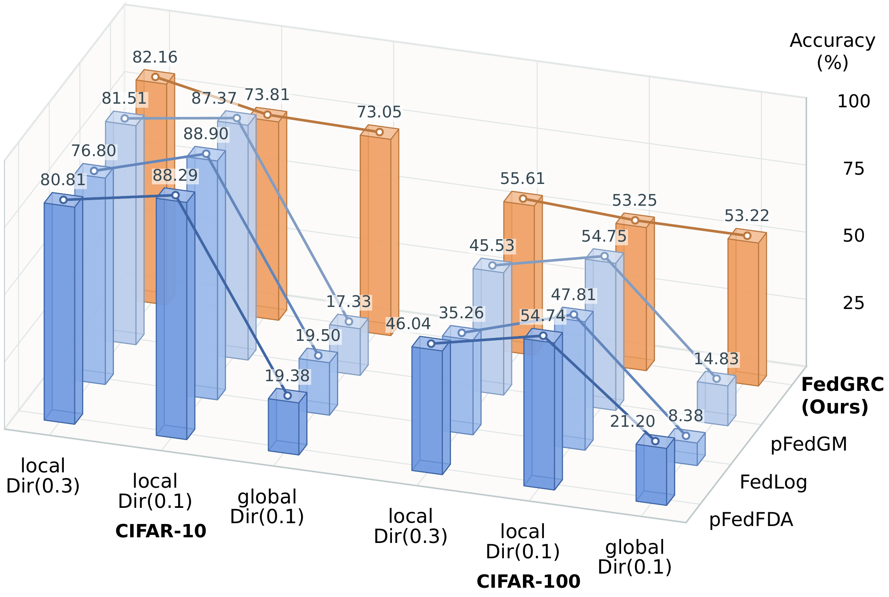
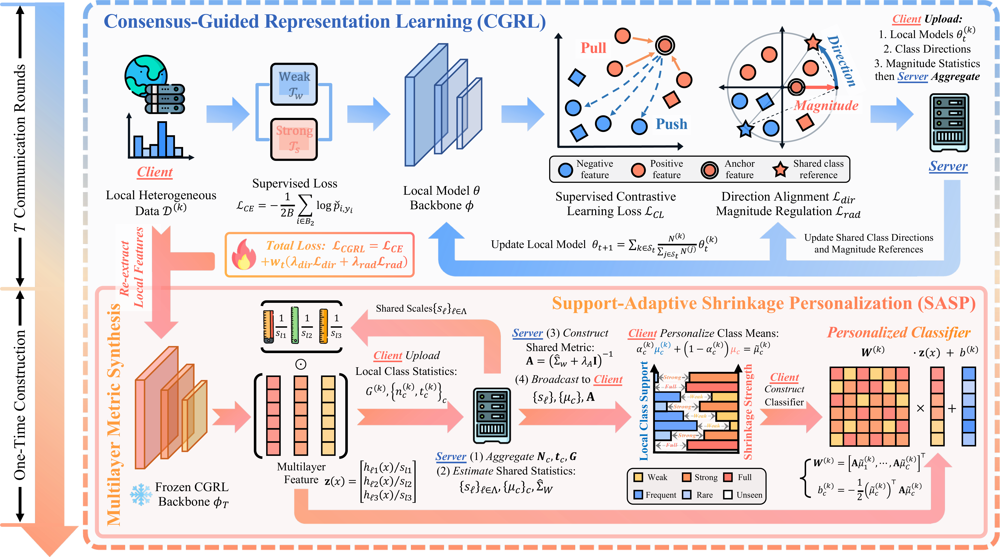

<p align="center">
  
</p>

<h3 align="center">Is High Local Accuracy Enough?<br>Geometric Consensus with Support-Adaptive Statistical Personalization for Federated Learning</h3>

<p align="center">
  Junyu Lin · Bosong Qi · Pengcheng Shi · Jiayuan Li<br>
  Wuhan University
</p>

<p align="center">
  <a href="#overview">✨ Overview</a> ·
  <a href="#quick-start">🚀 Quick Start</a> ·
  <a href="#methods">🧩 22 Methods</a> ·
  <a href="#commands">💻 Full Commands</a> ·
  <a href="#citation">📖 Citation</a>
</p>

**FedGRC combines geometric representation consensus with support-adaptive statistical personalization for local adaptation and full-label-space generalization.**

FedGRC-Benchmark evaluates FedGRC against **21 baselines: 15 complete federated learning methods and 6 statistical classifiers**, with the classifiers evaluated on **2 backbones: FedAvg, a foundational FL method, and FedYoYo, a representative novel FL method**. It covers **5 heterogeneous settings across 3 datasets—CIFAR-10, CIFAR-100, and FedRS—with label spaces of 10, 15, and 100 classes**. CIFAR uses **20 clients with full participation**, while FedRS integrates **8 remote-sensing datasets** with real-world heterogeneous distributions. For FedRS, we sample **10 of 135 clients per round** to simulate realistic heterogeneous and distributed FL scenarios.

The evaluation uses **8 metrics**: **local personalization (Local)**, **generalization across the full label space (Global)**, **locally unseen-class recognition (Unseen)**, **locally rare-class recognition (Rare)**, **local accuracy among the lowest-performing 25% of clients (L@25)**, **unseen-class accuracy among the lowest-performing 25% of clients (U@25)**, **rare-class accuracy among the lowest-performing 25% of clients (R@25)**, and **the recognition floor among the lowest-performing 25% of clients (F@25)**. All experiments in the paper use **3 random seeds**, with the main comparison results reported as **mean ± sample standard deviation**.

<a id="overview"></a>

## ✨ Overview

<p align="center">
  <a href="assets/fig1-combined.pdf">
    
  </a>
</p>

**Problem illustration.** Under stronger label heterogeneity, higher local accuracy does not necessarily indicate better recognition across the full label space. Local evaluation emphasizes frequent classes and can conceal weaknesses on locally rare or unseen classes.

<p align="center">
  <a href="assets/FedGRC-Overview.pdf">
    
  </a>
</p>

**Proposed method overview.** FedGRC uses consensus-guided representation learning (CGRL) to align class directions and regulate feature magnitudes across clients. Multilayer metric synthesis constructs a shared covariance metric, while support-adaptive shrinkage personalization (SASP) balances local and shared class means according to local sample counts, supporting local adaptation and recognition across the full label space.

<a id="quick-start"></a>

## 🚀 Quick Start

Use Python 3.11 on Linux x86_64 with an NVIDIA GPU with a CUDA 11.8-compatible driver. From the repository root, install the dependencies:

```bash
python -m pip install -r requirements.txt
```

The FedGRC Quick Start requires the implementation, which will be released upon acceptance. For the current public release, use the [baseline commands](#cmd-fedavg).

First download and extract the [CIFAR-10 partitions](#data). Then run a short FedGRC smoke test:

```bash
python main.py --algorithm FedGRC --dataset Cifar10/dir_a03_20c_gtest10 \
  --global_rounds 1 --local_epochs 1 --join_ratio 0.1 --batch_size 64 \
  --cgrl_warmup 1 --eval_gap 2 --goal 261015_quickstart --output_root results
```

This runs two aggregation steps with two clients per step, then builds MMS and SASP. Outputs are saved under `results/c10d03/seed1/FedGRC_261015_quickstart/`. For full training, use the [FedGRC commands](#cmd-fedgrc).

<a id="data"></a>

## 📊 Datasets & Evaluation

| Setting | `--dataset` | Partition | Classes | Clients | Image size |
|---|---|---|---:|---:|---:|
| c10d03 | `Cifar10/dir_a03_20c_gtest10` | Dirichlet α = 0.3 | 10 | 20 (full) | 32 × 32 |
| c10d01 | `Cifar10/dir_a01_20c_gtest10` | Dirichlet α = 0.1 | 10 | 20 (full) | 32 × 32 |
| c100d03 | `Cifar100/dir_a03_20c_gtest10` | Dirichlet α = 0.3 | 100 | 20 (full) | 32 × 32 |
| c100d01 | `Cifar100/dir_a01_20c_gtest10` | Dirichlet α = 0.1 | 100 | 20 (full) | 32 × 32 |
| fedrs | `FedRS` | NIID-1 | 15 | 135 (dynamic) | 64 × 64 |

`full`: all clients participate each round. `dynamic`: 10 of 135 clients are sampled each round.

[CIFAR](https://www.cs.toronto.edu/~kriz/cifar.html) and [FedRS-Bench](https://github.com/dongdongzhaoUP/FedRS-Bench) NIID-1 use a 75/25 local train/test split. CIFAR reserves a class-balanced global test set; FedRS uses its supplied global test set.

⚠️ The complete, pre-partitioned datasets in NPZ format are available in [Releases](https://github.com/JL181/FedGRC-Benchmark/releases). Download and extract the archives, then place the extracted `dataset/` folder in the repository root (`FedGRC-Benchmark/dataset/`) to use them directly.

<a id="evaluation"></a>

All client predictors use the complete federation label space. Evaluation reports:

| Metric | Meaning |
|---|---|
| Local | Sample-weighted accuracy across clients’ local test sets |
| Global | Class-balanced accuracy on the shared global test set, averaged across client predictors |
| Unseen | Accuracy on globally tested classes absent from each client's training data |
| Rare | Accuracy on the shared global test set for each client's two least-supported present classes |
| L@25 / U@25 / R@25 | Mean accuracies of the lowest-performing **25% of clients**, ranked separately by local, unseen-class, and rare-class accuracy |
| F@25 | Mean of the lowest **25% of client-level recognition floors**, where each floor is the minimum defined local, unseen-class, and rare-class accuracy |

<a id="methods"></a>

## 🧩 Methods

> 📌 **Paper under review.** The current public release includes the complete implementations of all **21 comparison baselines** and the **evaluation protocol**. Upon acceptance, we will release **(1) the complete FedGRC implementation** and **(2) model weights for all methods**, enabling direct verification of the paper's main findings and supporting usability and reproducibility.

This repo builds on [PFLlib](https://github.com/TsingZ0/PFLlib), further adapting its implementations of FedAvg, FedRep, FedROD, and FedLC for this benchmark by addressing implementation issues encountered during integration and refining selected details to better align with the original papers. The remaining baselines (FedTHE, FedETF, FedFA, pFedFDA, FedVLS, FedDr+, BTFL, HPFL, FedYoYo, FedLog, pFedGM, CCVR, FedNCM, Fed3R, FedCGS, FedCOF, and GH-LDA) are reproduced and integrated with reference to their official source code or original papers. All methods, including FedGRC, are evaluated within a unified experimental platform using the same dataset partitions, heterogeneity settings, and evaluation protocol to enable objective, fair, and reproducible comparisons.

<a id="complete-fl-methods"></a>

### 🔄 Complete FL Methods

| Method | Implementation | Commands | Venue | Title | Reference Source |
|---|---|---|---|---|---|
| **FedGRC** | Upon acceptance | [Run](#cmd-fedgrc) | Ours | Is High Local Accuracy Enough? Geometric Consensus with Support-Adaptive Statistical Personalization for Federated Learning | - |
| FedAvg | [Server](flcore/servers/serveravg.py) · [Client](flcore/clients/clientavg.py) | [Run](#cmd-fedavg) | AISTATS 2017 | [Communication-Efficient Learning of Deep Networks from Decentralized Data](https://arxiv.org/abs/1602.05629) | [PFLlib](https://github.com/TsingZ0/PFLlib) |
| FedRep | [Server](flcore/servers/serverrep.py) · [Client](flcore/clients/clientrep.py) | [Run](#cmd-fedrep) | ICML 2021 | [Exploiting Shared Representations for Personalized Federated Learning](https://arxiv.org/abs/2102.07078) | [PFLlib](https://github.com/TsingZ0/PFLlib) |
| FedROD | [Server](flcore/servers/serverrod.py) · [Client](flcore/clients/clientrod.py) | [Run](#cmd-fedrod) | ICLR 2022 | [On Bridging Generic and Personalized Federated Learning for Image Classification](https://arxiv.org/abs/2107.00778) | [PFLlib](https://github.com/TsingZ0/PFLlib) |
| FedLC | [Server](flcore/servers/serverlc.py) · [Client](flcore/clients/clientlc.py) | [Run](#cmd-fedlc) | ICML 2022 | [Federated Learning with Label Distribution Skew via Logits Calibration](https://arxiv.org/abs/2209.00189) | [PFLlib](https://github.com/TsingZ0/PFLlib) |
| FedTHE | [Server](flcore/servers/serverthe.py) · [Client](flcore/clients/clientthe.py) | [Run](#cmd-fedthe) | ICLR 2023 | [Test-Time Robust Personalization for Federated Learning](https://arxiv.org/abs/2205.10920) | [LINs-lab/FedTHE](https://github.com/LINs-lab/FedTHE) |
| FedETF | [Server](flcore/servers/serveretf.py) · [Client](flcore/clients/clientetf.py) | [Run](#cmd-fedetf) | ICCV 2023 | [No Fear of Classifier Biases: Neural Collapse Inspired Federated Learning with Synthetic and Fixed Classifier](https://arxiv.org/abs/2303.10058) | [ZexiLee/ICCV-2023-FedETF](https://github.com/ZexiLee/ICCV-2023-FedETF) |
| FedFA | [Server](flcore/servers/serverfa.py) · [Client](flcore/clients/clientfa.py) | [Run](#cmd-fedfa) | IEEE TMC 2024 | [FedFA: Federated Learning with Feature Anchors to Align Features and Classifiers for Heterogeneous Data](https://arxiv.org/abs/2211.09299) | [TailinZhou/FedFA](https://github.com/TailinZhou/FedFA) |
| pFedFDA | [Server](flcore/servers/serverfda.py) · [Client](flcore/clients/clientfda.py) | [Run](#cmd-pfedfda) | NeurIPS 2024 | [Personalized Federated Learning via Feature Distribution Adaptation](https://arxiv.org/abs/2411.00329) | [cj-mclaughlin/pFedFDA](https://github.com/cj-mclaughlin/pFedFDA) |
| FedVLS | [Server](flcore/servers/servervls.py) · [Client](flcore/clients/clientvls.py) | [Run](#cmd-fedvls) | AAAI 2025 | [Exploring Vacant Classes in Label-Skewed Federated Learning](https://arxiv.org/abs/2401.02329) | [krumpguo/FedVLS](https://github.com/krumpguo/FedVLS) |
| FedDrPlus (FedDr+) | [Server](flcore/servers/serverdrplus.py) · [Client](flcore/clients/clientdrplus.py) | [Run](#cmd-feddrplus) | TMLR 2025 | [FedDr+: Stabilizing Dot-regression with Global Feature Distillation for Federated Learning](https://arxiv.org/abs/2406.02355) | [curisam/FedDr_plus](https://github.com/curisam/FedDr_plus) |
| BTFL | [Server](flcore/servers/serverbtfl.py) · [Client](flcore/clients/clientbtfl.py) | [Run](#cmd-btfl) | KDD 2025 | [BTFL: A Bayesian-based Test-Time Generalization Method for Internal and External Data Distributions in Federated learning](https://arxiv.org/abs/2503.06633) | [ZhouYuCS/BTFL](https://github.com/ZhouYuCS/BTFL) |
| HPFL | [Server](flcore/servers/serverhpfl.py) · [Client](flcore/clients/clienthpfl.py) | [Run](#cmd-hpfl) | ICLR 2025 | [Hot-pluggable Federated Learning: Bridging General and Personalized FL via Dynamic Selection](https://proceedings.iclr.cc/paper_files/paper/2025/hash/fed9263d7f1086e735904ff690527a53-Abstract-Conference.html) | [tmlr-group/HPFL](https://github.com/tmlr-group/HPFL) |
| FedYoYo | [Server](flcore/servers/serveryoyo.py) · [Client](flcore/clients/clientyoyo.py) | [Run](#cmd-fedyoyo) | ICCV 2025 | [You Are Your Own Best Teacher: Achieving Centralized-level Performance in Federated Learning under Heterogeneous and Long-tailed Data](https://arxiv.org/abs/2503.06916) | [shanss132/FedYoYo](https://github.com/shanss132/FedYoYo) |
| FedLog | [Server](flcore/servers/serverfedlog.py) · [Client](flcore/clients/clientfedlog.py) | [Run](#cmd-fedlog) | TMLR 2026 | [FedLog: Personalized Federated Classification with Less Communication and More Flexibility](https://arxiv.org/abs/2407.08337) | [rossyu/fedlog](https://github.com/rossyu/fedlog) |
| pFedGM | [Server](flcore/servers/serverpfedgm.py) · [Client](flcore/clients/clientpfedgm.py) | [Run](#cmd-pfedgm) | arXiv 2026 | [Personalized Federated Learning via Gaussian Generative Modeling](https://arxiv.org/abs/2603.11620) | [Original paper](https://arxiv.org/abs/2603.11620) |

<a id="statistical-classifiers"></a>

### 📐 Statistical Classifiers

These six classifiers can use either a FedAvg or a FedYoYo backbone. Train the corresponding backbone first, then run the classifier command for the same dataset.

| Method | Implementation | Commands | Venue | Title | Reference Source |
|---|---|---|---|---|---|
| CCVR | [Server](flcore/servers/serverccvr.py) · [Client](flcore/clients/clientccvr.py) | [Run](#cmd-ccvr) | NeurIPS 2021 | [No Fear of Heterogeneity: Classifier Calibration for Federated Learning with Non-IID Data](https://arxiv.org/abs/2106.05001) | [Original paper](https://arxiv.org/abs/2106.05001) |
| FedNCM | [Server](flcore/servers/serverncm.py) · [Client](flcore/clients/clientncm.py) | [Run](#cmd-fedncm) | NeurIPS 2023 | [Guiding The Last Layer in Federated Learning with Pre-Trained Models](https://arxiv.org/abs/2306.03937) | [GwenLegate/GuidingLastLayerFLPretrain](https://github.com/GwenLegate/GuidingLastLayerFLPretrain) |
| Fed3R | [Server](flcore/servers/serverfed3r.py) · [Client](flcore/clients/clientfed3r.py) | [Run](#cmd-fed3r) | ICML 2024 | [Accelerating Heterogeneous Federated Learning with Closed-form Classifiers](https://arxiv.org/abs/2406.01116) | [Erosinho13/Fed3R](https://github.com/Erosinho13/Fed3R) |
| FedCGS | [Server](flcore/servers/servercgs.py) · [Client](flcore/clients/clientcgs.py) | [Run](#cmd-fedcgs) | AAAI 2025 | [Capture Global Feature Statistics for One-Shot Federated Learning](https://arxiv.org/abs/2503.06962) | [Yuqin-G/FedCGS](https://github.com/Yuqin-G/FedCGS) |
| FedCOF | [Server](flcore/servers/serverfedcof.py) · [Client](flcore/clients/clientfedcof.py) | [Run](#cmd-fedcof) | NeurIPS 2025 | [Covariances for Free: Exploiting Mean Distributions for Training-free Federated Learning](https://arxiv.org/abs/2412.14326) | [dipamgoswami/FedCOF](https://github.com/dipamgoswami/FedCOF) |
| GH-LDA | [Server](flcore/servers/serverghlda.py) · [Client](flcore/clients/clientghlda.py) | [Run](#cmd-ghlda) | ICLR 2026 | [The Gaussian-Head OFL Family: One-Shot Federated Learning from Client Global Statistics](https://arxiv.org/abs/2602.01186) | [FabioTur-dev/One-Shot-FL](https://github.com/FabioTur-dev/One-Shot-FL) |

<a id="commands"></a>

## 💻 Full Commands

The following 140 commands specify all run parameters for the five data settings. Method-specific hyperparameters are selected with reference to the original papers or official implementations to support a fair and representative comparison across datasets. Run them from the repository root.

Full commands use `--goal 261015` to label the experiment batch. Outputs are saved under `results/<dataset>/seed<seed>/<method>_<goal>/`, with the source method prefixed when using a supplied backbone (e.g., `FedAvg_HPFL_261015`). Use a different goal for each batch to avoid output conflicts; existing run directories are not overwritten. When changing a backbone run’s goal, update the corresponding `--backbone_ckpt` paths.

<a id="cmd-fedgrc"></a>

<details>
<summary><strong>FedGRC</strong> — 5 configurations</summary>

**c10d03**

```bash
python main.py \
  --algorithm FedGRC --dataset Cifar10/dir_a03_20c_gtest10 --num_classes 10 --num_clients 20 \
  --model ResNet18 --img_size 32 --device cuda --device_id 0 \
  --goal 261015 --global_rounds 200 --eval_gap 5 \
  --join_ratio 1.0 --batch_size 10 --local_learning_rate 0.005 --local_epochs 5 \
  --momentum 0.0 --weight_decay 0.0 --learning_rate_decay false --learning_rate_decay_gamma 0.99 \
  --rare_class_k 2 --ckpt_every 0 --data_root dataset \
  --output_root results --cgrl_lambda_dir 1 --cgrl_lambda_rad 1 --cgrl_beta 1 \
  --cgrl_temperature 0.1 --cgrl_warmup 50 --cgrl_direction_eta 0.5 --cgrl_radial_eta 0.5 \
  --cgrl_eps_r 1e-06 --cgrl_rmin 0.001 --mms_ridge_factor 0.1 --sasp_m0 64 \
  --grc_feature_batch_size 256
```

**c10d01**

```bash
python main.py \
  --algorithm FedGRC --dataset Cifar10/dir_a01_20c_gtest10 --num_classes 10 --num_clients 20 \
  --model ResNet18 --img_size 32 --device cuda --device_id 0 \
  --goal 261015 --global_rounds 200 --eval_gap 5 \
  --join_ratio 1.0 --batch_size 10 --local_learning_rate 0.005 --local_epochs 5 \
  --momentum 0.0 --weight_decay 0.0 --learning_rate_decay false --learning_rate_decay_gamma 0.99 \
  --rare_class_k 2 --ckpt_every 0 --data_root dataset \
  --output_root results --cgrl_lambda_dir 1 --cgrl_lambda_rad 1 --cgrl_beta 1 \
  --cgrl_temperature 0.1 --cgrl_warmup 50 --cgrl_direction_eta 0.5 --cgrl_radial_eta 0.5 \
  --cgrl_eps_r 1e-06 --cgrl_rmin 0.001 --mms_ridge_factor 0.1 --sasp_m0 64 \
  --grc_feature_batch_size 256
```

**c100d03**

```bash
python main.py \
  --algorithm FedGRC --dataset Cifar100/dir_a03_20c_gtest10 --num_classes 100 --num_clients 20 \
  --model ResNet18 --img_size 32 --device cuda --device_id 0 \
  --goal 261015 --global_rounds 300 --eval_gap 6 \
  --join_ratio 1.0 --batch_size 10 --local_learning_rate 0.005 --local_epochs 5 \
  --momentum 0.0 --weight_decay 0.0 --learning_rate_decay false --learning_rate_decay_gamma 0.99 \
  --rare_class_k 2 --ckpt_every 0 --data_root dataset \
  --output_root results --cgrl_lambda_dir 1 --cgrl_lambda_rad 1 --cgrl_beta 1 \
  --cgrl_temperature 0.1 --cgrl_warmup 50 --cgrl_direction_eta 0.5 --cgrl_radial_eta 0.5 \
  --cgrl_eps_r 1e-06 --cgrl_rmin 0.001 --mms_ridge_factor 0.1 --sasp_m0 64 \
  --grc_feature_batch_size 256
```

**c100d01**

```bash
python main.py \
  --algorithm FedGRC --dataset Cifar100/dir_a01_20c_gtest10 --num_classes 100 --num_clients 20 \
  --model ResNet18 --img_size 32 --device cuda --device_id 0 \
  --goal 261015 --global_rounds 300 --eval_gap 6 \
  --join_ratio 1.0 --batch_size 10 --local_learning_rate 0.005 --local_epochs 5 \
  --momentum 0.0 --weight_decay 0.0 --learning_rate_decay false --learning_rate_decay_gamma 0.99 \
  --rare_class_k 2 --ckpt_every 0 --data_root dataset \
  --output_root results --cgrl_lambda_dir 1 --cgrl_lambda_rad 1 --cgrl_beta 1 \
  --cgrl_temperature 0.1 --cgrl_warmup 50 --cgrl_direction_eta 0.5 --cgrl_radial_eta 0.5 \
  --cgrl_eps_r 1e-06 --cgrl_rmin 0.001 --mms_ridge_factor 0.1 --sasp_m0 64 \
  --grc_feature_batch_size 256
```

**fedrs**

```bash
python main.py \
  --algorithm FedGRC --dataset FedRS --num_classes 15 --num_clients 135 \
  --model ResNet18 --img_size 64 --device cuda --device_id 0 \
  --goal 261015 --global_rounds 500 --eval_gap 100 \
  --join_ratio 0.075 --batch_size 10 --local_learning_rate 0.005 --local_epochs 5 \
  --momentum 0.9 --weight_decay 1e-05 --learning_rate_decay false --learning_rate_decay_gamma 0.99 \
  --rare_class_k 2 --ckpt_every 0 --data_root dataset \
  --output_root results --cgrl_lambda_dir 1 --cgrl_lambda_rad 1 --cgrl_beta 1 \
  --cgrl_temperature 0.1 --cgrl_warmup 50 --cgrl_direction_eta 0.5 --cgrl_radial_eta 0.5 \
  --cgrl_eps_r 1e-06 --cgrl_rmin 0.001 --mms_ridge_factor 0.1 --sasp_m0 64 \
  --grc_feature_batch_size 256
```

</details>

<a id="cmd-fedavg"></a>

<details>
<summary><strong>FedAvg</strong> — 5 configurations</summary>

**c10d03**

```bash
python main.py \
  --algorithm FedAvg --dataset Cifar10/dir_a03_20c_gtest10 --num_classes 10 --num_clients 20 \
  --model ResNet18 --img_size 32 --device cuda --device_id 0 \
  --goal 261015 --global_rounds 200 --eval_gap 5 \
  --join_ratio 1.0 --batch_size 10 --local_learning_rate 0.005 --local_epochs 1 \
  --momentum 0.0 --weight_decay 0.0 --learning_rate_decay false --learning_rate_decay_gamma 0.99 \
  --rare_class_k 2 --ckpt_every 0 --data_root dataset \
  --output_root results
```

**c10d01**

```bash
python main.py \
  --algorithm FedAvg --dataset Cifar10/dir_a01_20c_gtest10 --num_classes 10 --num_clients 20 \
  --model ResNet18 --img_size 32 --device cuda --device_id 0 \
  --goal 261015 --global_rounds 200 --eval_gap 5 \
  --join_ratio 1.0 --batch_size 10 --local_learning_rate 0.005 --local_epochs 1 \
  --momentum 0.0 --weight_decay 0.0 --learning_rate_decay false --learning_rate_decay_gamma 0.99 \
  --rare_class_k 2 --ckpt_every 0 --data_root dataset \
  --output_root results
```

**c100d03**

```bash
python main.py \
  --algorithm FedAvg --dataset Cifar100/dir_a03_20c_gtest10 --num_classes 100 --num_clients 20 \
  --model ResNet18 --img_size 32 --device cuda --device_id 0 \
  --goal 261015 --global_rounds 300 --eval_gap 6 \
  --join_ratio 1.0 --batch_size 10 --local_learning_rate 0.005 --local_epochs 1 \
  --momentum 0.0 --weight_decay 0.0 --learning_rate_decay false --learning_rate_decay_gamma 0.99 \
  --rare_class_k 2 --ckpt_every 0 --data_root dataset \
  --output_root results
```

**c100d01**

```bash
python main.py \
  --algorithm FedAvg --dataset Cifar100/dir_a01_20c_gtest10 --num_classes 100 --num_clients 20 \
  --model ResNet18 --img_size 32 --device cuda --device_id 0 \
  --goal 261015 --global_rounds 300 --eval_gap 6 \
  --join_ratio 1.0 --batch_size 10 --local_learning_rate 0.005 --local_epochs 1 \
  --momentum 0.0 --weight_decay 0.0 --learning_rate_decay false --learning_rate_decay_gamma 0.99 \
  --rare_class_k 2 --ckpt_every 0 --data_root dataset \
  --output_root results
```

**fedrs**

```bash
python main.py \
  --algorithm FedAvg --dataset FedRS --num_classes 15 --num_clients 135 \
  --model ResNet18 --img_size 64 --device cuda --device_id 0 \
  --goal 261015 --global_rounds 500 --eval_gap 100 \
  --join_ratio 0.075 --batch_size 10 --local_learning_rate 0.005 --local_epochs 5 \
  --momentum 0.9 --weight_decay 1e-05 --learning_rate_decay false --learning_rate_decay_gamma 0.99 \
  --rare_class_k 2 --ckpt_every 10 --data_root dataset \
  --output_root results
```

</details>

<a id="cmd-fedrep"></a>

<details>
<summary><strong>FedRep</strong> — 5 configurations</summary>

**c10d03**

```bash
python main.py \
  --algorithm FedRep --dataset Cifar10/dir_a03_20c_gtest10 --num_classes 10 --num_clients 20 \
  --model ResNet18 --img_size 32 --device cuda --device_id 0 \
  --goal 261015 --global_rounds 200 --eval_gap 5 \
  --join_ratio 1.0 --batch_size 10 --local_learning_rate 0.005 --local_epochs 1 \
  --momentum 0.0 --weight_decay 0.0 --learning_rate_decay false --learning_rate_decay_gamma 0.99 \
  --rare_class_k 2 --ckpt_every 0 --data_root dataset \
  --output_root results --plocal_epochs 5
```

**c10d01**

```bash
python main.py \
  --algorithm FedRep --dataset Cifar10/dir_a01_20c_gtest10 --num_classes 10 --num_clients 20 \
  --model ResNet18 --img_size 32 --device cuda --device_id 0 \
  --goal 261015 --global_rounds 200 --eval_gap 5 \
  --join_ratio 1.0 --batch_size 10 --local_learning_rate 0.005 --local_epochs 1 \
  --momentum 0.0 --weight_decay 0.0 --learning_rate_decay false --learning_rate_decay_gamma 0.99 \
  --rare_class_k 2 --ckpt_every 0 --data_root dataset \
  --output_root results --plocal_epochs 5
```

**c100d03**

```bash
python main.py \
  --algorithm FedRep --dataset Cifar100/dir_a03_20c_gtest10 --num_classes 100 --num_clients 20 \
  --model ResNet18 --img_size 32 --device cuda --device_id 0 \
  --goal 261015 --global_rounds 300 --eval_gap 6 \
  --join_ratio 1.0 --batch_size 10 --local_learning_rate 0.005 --local_epochs 1 \
  --momentum 0.0 --weight_decay 0.0 --learning_rate_decay false --learning_rate_decay_gamma 0.99 \
  --rare_class_k 2 --ckpt_every 0 --data_root dataset \
  --output_root results --plocal_epochs 5
```

**c100d01**

```bash
python main.py \
  --algorithm FedRep --dataset Cifar100/dir_a01_20c_gtest10 --num_classes 100 --num_clients 20 \
  --model ResNet18 --img_size 32 --device cuda --device_id 0 \
  --goal 261015 --global_rounds 300 --eval_gap 6 \
  --join_ratio 1.0 --batch_size 10 --local_learning_rate 0.005 --local_epochs 1 \
  --momentum 0.0 --weight_decay 0.0 --learning_rate_decay false --learning_rate_decay_gamma 0.99 \
  --rare_class_k 2 --ckpt_every 0 --data_root dataset \
  --output_root results --plocal_epochs 5
```

**fedrs**

```bash
python main.py \
  --algorithm FedRep --dataset FedRS --num_classes 15 --num_clients 135 \
  --model ResNet18 --img_size 64 --device cuda --device_id 0 \
  --goal 261015 --global_rounds 500 --eval_gap 20 \
  --join_ratio 0.075 --batch_size 10 --local_learning_rate 0.005 --local_epochs 5 \
  --momentum 0.9 --weight_decay 1e-05 --learning_rate_decay false --learning_rate_decay_gamma 0.99 \
  --rare_class_k 2 --ckpt_every 0 --data_root dataset \
  --output_root results --plocal_epochs 5
```

</details>

<a id="cmd-fedrod"></a>

<details>
<summary><strong>FedROD</strong> — 5 configurations</summary>

**c10d03**

```bash
python main.py \
  --algorithm FedROD --dataset Cifar10/dir_a03_20c_gtest10 --num_classes 10 --num_clients 20 \
  --model ResNet18 --img_size 32 --device cuda --device_id 0 \
  --goal 261015 --global_rounds 200 --eval_gap 5 \
  --join_ratio 1.0 --batch_size 10 --local_learning_rate 0.005 --local_epochs 1 \
  --momentum 0.0 --weight_decay 0.0 --learning_rate_decay false --learning_rate_decay_gamma 0.99 \
  --rare_class_k 2 --ckpt_every 0 --data_root dataset \
  --output_root results
```

**c10d01**

```bash
python main.py \
  --algorithm FedROD --dataset Cifar10/dir_a01_20c_gtest10 --num_classes 10 --num_clients 20 \
  --model ResNet18 --img_size 32 --device cuda --device_id 0 \
  --goal 261015 --global_rounds 200 --eval_gap 5 \
  --join_ratio 1.0 --batch_size 10 --local_learning_rate 0.005 --local_epochs 1 \
  --momentum 0.0 --weight_decay 0.0 --learning_rate_decay false --learning_rate_decay_gamma 0.99 \
  --rare_class_k 2 --ckpt_every 0 --data_root dataset \
  --output_root results
```

**c100d03**

```bash
python main.py \
  --algorithm FedROD --dataset Cifar100/dir_a03_20c_gtest10 --num_classes 100 --num_clients 20 \
  --model ResNet18 --img_size 32 --device cuda --device_id 0 \
  --goal 261015 --global_rounds 300 --eval_gap 6 \
  --join_ratio 1.0 --batch_size 10 --local_learning_rate 0.005 --local_epochs 1 \
  --momentum 0.0 --weight_decay 0.0 --learning_rate_decay false --learning_rate_decay_gamma 0.99 \
  --rare_class_k 2 --ckpt_every 0 --data_root dataset \
  --output_root results
```

**c100d01**

```bash
python main.py \
  --algorithm FedROD --dataset Cifar100/dir_a01_20c_gtest10 --num_classes 100 --num_clients 20 \
  --model ResNet18 --img_size 32 --device cuda --device_id 0 \
  --goal 261015 --global_rounds 300 --eval_gap 6 \
  --join_ratio 1.0 --batch_size 10 --local_learning_rate 0.005 --local_epochs 1 \
  --momentum 0.0 --weight_decay 0.0 --learning_rate_decay false --learning_rate_decay_gamma 0.99 \
  --rare_class_k 2 --ckpt_every 0 --data_root dataset \
  --output_root results
```

**fedrs**

```bash
python main.py \
  --algorithm FedROD --dataset FedRS --num_classes 15 --num_clients 135 \
  --model ResNet18 --img_size 64 --device cuda --device_id 0 \
  --goal 261015 --global_rounds 500 --eval_gap 20 \
  --join_ratio 0.075 --batch_size 10 --local_learning_rate 0.005 --local_epochs 5 \
  --momentum 0.9 --weight_decay 1e-05 --learning_rate_decay false --learning_rate_decay_gamma 0.99 \
  --rare_class_k 2 --ckpt_every 0 --data_root dataset \
  --output_root results
```

</details>

<a id="cmd-fedlc"></a>

<details>
<summary><strong>FedLC</strong> — 5 configurations</summary>

**c10d03**

```bash
python main.py \
  --algorithm FedLC --dataset Cifar10/dir_a03_20c_gtest10 --num_classes 10 --num_clients 20 \
  --model ResNet18 --img_size 32 --device cuda --device_id 0 \
  --goal 261015 --global_rounds 200 --eval_gap 5 \
  --join_ratio 1.0 --batch_size 10 --local_learning_rate 0.005 --local_epochs 5 \
  --momentum 0.0 --weight_decay 0.0 --learning_rate_decay false --learning_rate_decay_gamma 0.99 \
  --rare_class_k 2 --ckpt_every 0 --data_root dataset \
  --output_root results --tau 6 --lc_missing_cap 10000
```

**c10d01**

```bash
python main.py \
  --algorithm FedLC --dataset Cifar10/dir_a01_20c_gtest10 --num_classes 10 --num_clients 20 \
  --model ResNet18 --img_size 32 --device cuda --device_id 0 \
  --goal 261015 --global_rounds 200 --eval_gap 5 \
  --join_ratio 1.0 --batch_size 10 --local_learning_rate 0.005 --local_epochs 5 \
  --momentum 0.0 --weight_decay 0.0 --learning_rate_decay false --learning_rate_decay_gamma 0.99 \
  --rare_class_k 2 --ckpt_every 0 --data_root dataset \
  --output_root results --tau 6 --lc_missing_cap 10000
```

**c100d03**

```bash
python main.py \
  --algorithm FedLC --dataset Cifar100/dir_a03_20c_gtest10 --num_classes 100 --num_clients 20 \
  --model ResNet18 --img_size 32 --device cuda --device_id 0 \
  --goal 261015 --global_rounds 300 --eval_gap 6 \
  --join_ratio 1.0 --batch_size 10 --local_learning_rate 0.005 --local_epochs 5 \
  --momentum 0.0 --weight_decay 0.0 --learning_rate_decay false --learning_rate_decay_gamma 0.99 \
  --rare_class_k 2 --ckpt_every 0 --data_root dataset \
  --output_root results --tau 6 --lc_missing_cap 10000
```

**c100d01**

```bash
python main.py \
  --algorithm FedLC --dataset Cifar100/dir_a01_20c_gtest10 --num_classes 100 --num_clients 20 \
  --model ResNet18 --img_size 32 --device cuda --device_id 0 \
  --goal 261015 --global_rounds 300 --eval_gap 6 \
  --join_ratio 1.0 --batch_size 10 --local_learning_rate 0.005 --local_epochs 5 \
  --momentum 0.0 --weight_decay 0.0 --learning_rate_decay false --learning_rate_decay_gamma 0.99 \
  --rare_class_k 2 --ckpt_every 0 --data_root dataset \
  --output_root results --tau 6 --lc_missing_cap 10000
```

**fedrs**

```bash
python main.py \
  --algorithm FedLC --dataset FedRS --num_classes 15 --num_clients 135 \
  --model ResNet18 --img_size 64 --device cuda --device_id 0 \
  --goal 261015 --global_rounds 500 --eval_gap 20 \
  --join_ratio 0.075 --batch_size 10 --local_learning_rate 0.005 --local_epochs 5 \
  --momentum 0.9 --weight_decay 1e-05 --learning_rate_decay false --learning_rate_decay_gamma 0.99 \
  --rare_class_k 2 --ckpt_every 0 --data_root dataset \
  --output_root results --tau 6 --lc_missing_cap 10000
```

</details>

<a id="cmd-fedthe"></a>

<details>
<summary><strong>FedTHE</strong> — 5 configurations</summary>

**c10d03**

```bash
python main.py \
  --algorithm FedTHE --dataset Cifar10/dir_a03_20c_gtest10 --num_classes 10 --num_clients 20 \
  --model ResNet18 --img_size 32 --device cuda --device_id 0 \
  --goal 261015 --global_rounds 200 --eval_gap 5 \
  --join_ratio 1.0 --batch_size 32 --local_learning_rate 0.01 --local_epochs 5 \
  --momentum 0.0 --weight_decay 0.0 --learning_rate_decay false --learning_rate_decay_gamma 0.99 \
  --rare_class_k 2 --ckpt_every 0 --data_root dataset \
  --output_root results --the_steps 20 --the_alpha 0.1 --the_beta 0.3 \
  --the_personal_lr 0.01 --the_personal_epochs 1
```

**c10d01**

```bash
python main.py \
  --algorithm FedTHE --dataset Cifar10/dir_a01_20c_gtest10 --num_classes 10 --num_clients 20 \
  --model ResNet18 --img_size 32 --device cuda --device_id 0 \
  --goal 261015 --global_rounds 200 --eval_gap 5 \
  --join_ratio 1.0 --batch_size 32 --local_learning_rate 0.01 --local_epochs 5 \
  --momentum 0.0 --weight_decay 0.0 --learning_rate_decay false --learning_rate_decay_gamma 0.99 \
  --rare_class_k 2 --ckpt_every 0 --data_root dataset \
  --output_root results --the_steps 20 --the_alpha 0.1 --the_beta 0.3 \
  --the_personal_lr 0.01 --the_personal_epochs 1
```

**c100d03**

```bash
python main.py \
  --algorithm FedTHE --dataset Cifar100/dir_a03_20c_gtest10 --num_classes 100 --num_clients 20 \
  --model ResNet18 --img_size 32 --device cuda --device_id 0 \
  --goal 261015 --global_rounds 300 --eval_gap 6 \
  --join_ratio 1.0 --batch_size 32 --local_learning_rate 0.01 --local_epochs 5 \
  --momentum 0.0 --weight_decay 0.0 --learning_rate_decay false --learning_rate_decay_gamma 0.99 \
  --rare_class_k 2 --ckpt_every 0 --data_root dataset \
  --output_root results --the_steps 20 --the_alpha 0.1 --the_beta 0.3 \
  --the_personal_lr 0.01 --the_personal_epochs 1
```

**c100d01**

```bash
python main.py \
  --algorithm FedTHE --dataset Cifar100/dir_a01_20c_gtest10 --num_classes 100 --num_clients 20 \
  --model ResNet18 --img_size 32 --device cuda --device_id 0 \
  --goal 261015 --global_rounds 300 --eval_gap 6 \
  --join_ratio 1.0 --batch_size 32 --local_learning_rate 0.01 --local_epochs 5 \
  --momentum 0.0 --weight_decay 0.0 --learning_rate_decay false --learning_rate_decay_gamma 0.99 \
  --rare_class_k 2 --ckpt_every 0 --data_root dataset \
  --output_root results --the_steps 20 --the_alpha 0.1 --the_beta 0.3 \
  --the_personal_lr 0.01 --the_personal_epochs 1
```

**fedrs**

```bash
python main.py \
  --algorithm FedTHE --dataset FedRS --num_classes 15 --num_clients 135 \
  --model ResNet18 --img_size 64 --device cuda --device_id 0 \
  --goal 261015 --global_rounds 500 --eval_gap 20 \
  --join_ratio 0.075 --batch_size 32 --local_learning_rate 0.01 --local_epochs 5 \
  --momentum 0.9 --weight_decay 1e-05 --learning_rate_decay false --learning_rate_decay_gamma 0.99 \
  --rare_class_k 2 --ckpt_every 0 --data_root dataset \
  --output_root results --the_steps 20 --the_alpha 0.1 --the_beta 0.3 \
  --the_personal_lr 0.01 --the_personal_epochs 1
```

</details>

<a id="cmd-fedetf"></a>

<details>
<summary><strong>FedETF</strong> — 5 configurations</summary>

**c10d03**

```bash
python main.py \
  --algorithm FedETF --dataset Cifar10/dir_a03_20c_gtest10 --num_classes 10 --num_clients 20 \
  --model ResNet18 --img_size 32 --device cuda --device_id 0 \
  --goal 261015 --global_rounds 200 --eval_gap 5 \
  --join_ratio 1.0 --batch_size 128 --local_learning_rate 0.04 --local_epochs 3 \
  --momentum 0.9 --weight_decay 0.0005 --learning_rate_decay false --learning_rate_decay_gamma 0.99 \
  --rare_class_k 2 --ckpt_every 0 --data_root dataset \
  --output_root results --etf_personalization_rounds 20 --etf_personalization_inner_steps 3 --etf_proto_lr 0.1 \
  --etf_proj_lr 0.05
```

**c10d01**

```bash
python main.py \
  --algorithm FedETF --dataset Cifar10/dir_a01_20c_gtest10 --num_classes 10 --num_clients 20 \
  --model ResNet18 --img_size 32 --device cuda --device_id 0 \
  --goal 261015 --global_rounds 200 --eval_gap 5 \
  --join_ratio 1.0 --batch_size 128 --local_learning_rate 0.04 --local_epochs 3 \
  --momentum 0.9 --weight_decay 0.0005 --learning_rate_decay false --learning_rate_decay_gamma 0.99 \
  --rare_class_k 2 --ckpt_every 0 --data_root dataset \
  --output_root results --etf_personalization_rounds 20 --etf_personalization_inner_steps 3 --etf_proto_lr 0.1 \
  --etf_proj_lr 0.05
```

**c100d03**

```bash
python main.py \
  --algorithm FedETF --dataset Cifar100/dir_a03_20c_gtest10 --num_classes 100 --num_clients 20 \
  --model ResNet18 --img_size 32 --device cuda --device_id 0 \
  --goal 261015 --global_rounds 300 --eval_gap 6 \
  --join_ratio 1.0 --batch_size 128 --local_learning_rate 0.04 --local_epochs 3 \
  --momentum 0.9 --weight_decay 0.0005 --learning_rate_decay false --learning_rate_decay_gamma 0.99 \
  --rare_class_k 2 --ckpt_every 0 --data_root dataset \
  --output_root results --etf_personalization_rounds 20 --etf_personalization_inner_steps 3 --etf_proto_lr 0.1 \
  --etf_proj_lr 0.05
```

**c100d01**

```bash
python main.py \
  --algorithm FedETF --dataset Cifar100/dir_a01_20c_gtest10 --num_classes 100 --num_clients 20 \
  --model ResNet18 --img_size 32 --device cuda --device_id 0 \
  --goal 261015 --global_rounds 300 --eval_gap 6 \
  --join_ratio 1.0 --batch_size 128 --local_learning_rate 0.04 --local_epochs 3 \
  --momentum 0.9 --weight_decay 0.0005 --learning_rate_decay false --learning_rate_decay_gamma 0.99 \
  --rare_class_k 2 --ckpt_every 0 --data_root dataset \
  --output_root results --etf_personalization_rounds 20 --etf_personalization_inner_steps 3 --etf_proto_lr 0.1 \
  --etf_proj_lr 0.05
```

**fedrs**

```bash
python main.py \
  --algorithm FedETF --dataset FedRS --num_classes 15 --num_clients 135 \
  --model ResNet18 --img_size 64 --device cuda --device_id 0 \
  --goal 261015 --global_rounds 500 --eval_gap 20 \
  --join_ratio 0.075 --batch_size 128 --local_learning_rate 0.04 --local_epochs 5 \
  --momentum 0.9 --weight_decay 0.0005 --learning_rate_decay false --learning_rate_decay_gamma 0.99 \
  --rare_class_k 2 --ckpt_every 0 --data_root dataset \
  --output_root results --etf_personalization_rounds 20 --etf_personalization_inner_steps 3 --etf_proto_lr 0.1 \
  --etf_proj_lr 0.05
```

</details>

<a id="cmd-fedfa"></a>

<details>
<summary><strong>FedFA</strong> — 5 configurations</summary>

**c10d03**

```bash
python main.py \
  --algorithm FedFA --dataset Cifar10/dir_a03_20c_gtest10 --num_classes 10 --num_clients 20 \
  --model ResNet18 --img_size 32 --device cuda --device_id 0 \
  --goal 261015 --global_rounds 200 --eval_gap 5 \
  --join_ratio 1.0 --batch_size 64 --local_learning_rate 0.01 --local_epochs 5 \
  --momentum 0.0 --weight_decay 0.0 --learning_rate_decay false --learning_rate_decay_gamma 0.99 \
  --rare_class_k 2 --ckpt_every 0 --data_root dataset \
  --output_root results --fedfa_mu 0.1 --fedfa_anchor_momentum 0.5 --fedfa_calibration_lr 0.001
```

**c10d01**

```bash
python main.py \
  --algorithm FedFA --dataset Cifar10/dir_a01_20c_gtest10 --num_classes 10 --num_clients 20 \
  --model ResNet18 --img_size 32 --device cuda --device_id 0 \
  --goal 261015 --global_rounds 200 --eval_gap 5 \
  --join_ratio 1.0 --batch_size 64 --local_learning_rate 0.01 --local_epochs 5 \
  --momentum 0.0 --weight_decay 0.0 --learning_rate_decay false --learning_rate_decay_gamma 0.99 \
  --rare_class_k 2 --ckpt_every 0 --data_root dataset \
  --output_root results --fedfa_mu 0.1 --fedfa_anchor_momentum 0.5 --fedfa_calibration_lr 0.001
```

**c100d03**

```bash
python main.py \
  --algorithm FedFA --dataset Cifar100/dir_a03_20c_gtest10 --num_classes 100 --num_clients 20 \
  --model ResNet18 --img_size 32 --device cuda --device_id 0 \
  --goal 261015 --global_rounds 300 --eval_gap 6 \
  --join_ratio 1.0 --batch_size 64 --local_learning_rate 0.01 --local_epochs 5 \
  --momentum 0.0 --weight_decay 0.0 --learning_rate_decay false --learning_rate_decay_gamma 0.99 \
  --rare_class_k 2 --ckpt_every 0 --data_root dataset \
  --output_root results --fedfa_mu 0.1 --fedfa_anchor_momentum 0.5 --fedfa_calibration_lr 0.001
```

**c100d01**

```bash
python main.py \
  --algorithm FedFA --dataset Cifar100/dir_a01_20c_gtest10 --num_classes 100 --num_clients 20 \
  --model ResNet18 --img_size 32 --device cuda --device_id 0 \
  --goal 261015 --global_rounds 300 --eval_gap 6 \
  --join_ratio 1.0 --batch_size 64 --local_learning_rate 0.01 --local_epochs 5 \
  --momentum 0.0 --weight_decay 0.0 --learning_rate_decay false --learning_rate_decay_gamma 0.99 \
  --rare_class_k 2 --ckpt_every 0 --data_root dataset \
  --output_root results --fedfa_mu 0.1 --fedfa_anchor_momentum 0.5 --fedfa_calibration_lr 0.001
```

**fedrs**

```bash
python main.py \
  --algorithm FedFA --dataset FedRS --num_classes 15 --num_clients 135 \
  --model ResNet18 --img_size 64 --device cuda --device_id 0 \
  --goal 261015 --global_rounds 500 --eval_gap 100 \
  --join_ratio 0.075 --batch_size 64 --local_learning_rate 0.01 --local_epochs 5 \
  --momentum 0.9 --weight_decay 1e-05 --learning_rate_decay false --learning_rate_decay_gamma 0.99 \
  --rare_class_k 2 --ckpt_every 10 --data_root dataset \
  --output_root results --fedfa_mu 0.1 --fedfa_anchor_momentum 0.5 --fedfa_calibration_lr 0.001
```

</details>

<a id="cmd-pfedfda"></a>

<details>
<summary><strong>pFedFDA</strong> — 5 configurations</summary>

**c10d03**

```bash
python main.py \
  --algorithm pFedFDA --dataset Cifar10/dir_a03_20c_gtest10 --num_classes 10 --num_clients 20 \
  --model ResNet18 --img_size 32 --device cuda --device_id 0 \
  --goal 261015 --global_rounds 200 --eval_gap 5 \
  --join_ratio 1.0 --batch_size 50 --local_learning_rate 0.01 --local_epochs 5 \
  --momentum 0.5 --weight_decay 0.0005 --learning_rate_decay false --learning_rate_decay_gamma 0.99 \
  --rare_class_k 2 --ckpt_every 0 --data_root dataset \
  --output_root results --single_beta 1 --local_beta false
```

**c10d01**

```bash
python main.py \
  --algorithm pFedFDA --dataset Cifar10/dir_a01_20c_gtest10 --num_classes 10 --num_clients 20 \
  --model ResNet18 --img_size 32 --device cuda --device_id 0 \
  --goal 261015 --global_rounds 200 --eval_gap 5 \
  --join_ratio 1.0 --batch_size 50 --local_learning_rate 0.01 --local_epochs 5 \
  --momentum 0.5 --weight_decay 0.0005 --learning_rate_decay false --learning_rate_decay_gamma 0.99 \
  --rare_class_k 2 --ckpt_every 0 --data_root dataset \
  --output_root results --single_beta 1 --local_beta false
```

**c100d03**

```bash
python main.py \
  --algorithm pFedFDA --dataset Cifar100/dir_a03_20c_gtest10 --num_classes 100 --num_clients 20 \
  --model ResNet18 --img_size 32 --device cuda --device_id 0 \
  --goal 261015 --global_rounds 300 --eval_gap 6 \
  --join_ratio 1.0 --batch_size 50 --local_learning_rate 0.01 --local_epochs 5 \
  --momentum 0.5 --weight_decay 0.0005 --learning_rate_decay false --learning_rate_decay_gamma 0.99 \
  --rare_class_k 2 --ckpt_every 0 --data_root dataset \
  --output_root results --single_beta 1 --local_beta false
```

**c100d01**

```bash
python main.py \
  --algorithm pFedFDA --dataset Cifar100/dir_a01_20c_gtest10 --num_classes 100 --num_clients 20 \
  --model ResNet18 --img_size 32 --device cuda --device_id 0 \
  --goal 261015 --global_rounds 300 --eval_gap 6 \
  --join_ratio 1.0 --batch_size 50 --local_learning_rate 0.01 --local_epochs 5 \
  --momentum 0.5 --weight_decay 0.0005 --learning_rate_decay false --learning_rate_decay_gamma 0.99 \
  --rare_class_k 2 --ckpt_every 0 --data_root dataset \
  --output_root results --single_beta 1 --local_beta false
```

**fedrs**

```bash
python main.py \
  --algorithm pFedFDA --dataset FedRS --num_classes 15 --num_clients 135 \
  --model ResNet18 --img_size 64 --device cuda --device_id 0 \
  --goal 261015 --global_rounds 500 --eval_gap 20 \
  --join_ratio 0.075 --batch_size 50 --local_learning_rate 0.01 --local_epochs 5 \
  --momentum 0.9 --weight_decay 1e-05 --learning_rate_decay false --learning_rate_decay_gamma 0.99 \
  --rare_class_k 2 --ckpt_every 0 --data_root dataset \
  --output_root results --single_beta 1 --local_beta false
```

</details>

<a id="cmd-fedvls"></a>

<details>
<summary><strong>FedVLS</strong> — 5 configurations</summary>

**c10d03**

```bash
python main.py \
  --algorithm FedVLS --dataset Cifar10/dir_a03_20c_gtest10 --num_classes 10 --num_clients 20 \
  --model ResNet18 --img_size 32 --device cuda --device_id 0 \
  --goal 261015 --global_rounds 200 --eval_gap 5 \
  --join_ratio 1.0 --batch_size 64 --local_learning_rate 0.01 --local_epochs 10 \
  --momentum 0.9 --weight_decay 0.0 --learning_rate_decay false --learning_rate_decay_gamma 0.99 \
  --rare_class_k 2 --ckpt_every 0 --data_root dataset \
  --output_root results --lamda 0.1
```

**c10d01**

```bash
python main.py \
  --algorithm FedVLS --dataset Cifar10/dir_a01_20c_gtest10 --num_classes 10 --num_clients 20 \
  --model ResNet18 --img_size 32 --device cuda --device_id 0 \
  --goal 261015 --global_rounds 200 --eval_gap 5 \
  --join_ratio 1.0 --batch_size 64 --local_learning_rate 0.01 --local_epochs 10 \
  --momentum 0.9 --weight_decay 0.0 --learning_rate_decay false --learning_rate_decay_gamma 0.99 \
  --rare_class_k 2 --ckpt_every 0 --data_root dataset \
  --output_root results --lamda 0.1
```

**c100d03**

```bash
python main.py \
  --algorithm FedVLS --dataset Cifar100/dir_a03_20c_gtest10 --num_classes 100 --num_clients 20 \
  --model ResNet18 --img_size 32 --device cuda --device_id 0 \
  --goal 261015 --global_rounds 300 --eval_gap 6 \
  --join_ratio 1.0 --batch_size 64 --local_learning_rate 0.01 --local_epochs 10 \
  --momentum 0.9 --weight_decay 0.0 --learning_rate_decay false --learning_rate_decay_gamma 0.99 \
  --rare_class_k 2 --ckpt_every 0 --data_root dataset \
  --output_root results --lamda 0.1
```

**c100d01**

```bash
python main.py \
  --algorithm FedVLS --dataset Cifar100/dir_a01_20c_gtest10 --num_classes 100 --num_clients 20 \
  --model ResNet18 --img_size 32 --device cuda --device_id 0 \
  --goal 261015 --global_rounds 300 --eval_gap 6 \
  --join_ratio 1.0 --batch_size 64 --local_learning_rate 0.01 --local_epochs 10 \
  --momentum 0.9 --weight_decay 0.0 --learning_rate_decay false --learning_rate_decay_gamma 0.99 \
  --rare_class_k 2 --ckpt_every 0 --data_root dataset \
  --output_root results --lamda 0.1
```

**fedrs**

```bash
python main.py \
  --algorithm FedVLS --dataset FedRS --num_classes 15 --num_clients 135 \
  --model ResNet18 --img_size 64 --device cuda --device_id 0 \
  --goal 261015 --global_rounds 500 --eval_gap 20 \
  --join_ratio 0.075 --batch_size 64 --local_learning_rate 0.01 --local_epochs 5 \
  --momentum 0.9 --weight_decay 1e-05 --learning_rate_decay false --learning_rate_decay_gamma 0.99 \
  --rare_class_k 2 --ckpt_every 0 --data_root dataset \
  --output_root results --lamda 0.1
```

</details>

<a id="cmd-feddrplus"></a>

<details>
<summary><strong>FedDrPlus</strong> — 5 configurations</summary>

**c10d03**

```bash
python main.py \
  --algorithm FedDrPlus --dataset Cifar10/dir_a03_20c_gtest10 --num_classes 10 --num_clients 20 \
  --model ResNet18 --img_size 32 --device cuda --device_id 0 \
  --goal 261015 --global_rounds 200 --eval_gap 5 \
  --join_ratio 1.0 --batch_size 10 --local_learning_rate 0.175 --local_epochs 5 \
  --momentum 0.9 --weight_decay 1e-05 --learning_rate_decay false --learning_rate_decay_gamma 0.99 \
  --rare_class_k 2 --ckpt_every 0 --data_root dataset \
  --output_root results --drp_beta 0.9
```

**c10d01**

```bash
python main.py \
  --algorithm FedDrPlus --dataset Cifar10/dir_a01_20c_gtest10 --num_classes 10 --num_clients 20 \
  --model ResNet18 --img_size 32 --device cuda --device_id 0 \
  --goal 261015 --global_rounds 200 --eval_gap 5 \
  --join_ratio 1.0 --batch_size 10 --local_learning_rate 0.175 --local_epochs 5 \
  --momentum 0.9 --weight_decay 1e-05 --learning_rate_decay false --learning_rate_decay_gamma 0.99 \
  --rare_class_k 2 --ckpt_every 0 --data_root dataset \
  --output_root results --drp_beta 0.9
```

**c100d03**

```bash
python main.py \
  --algorithm FedDrPlus --dataset Cifar100/dir_a03_20c_gtest10 --num_classes 100 --num_clients 20 \
  --model ResNet18 --img_size 32 --device cuda --device_id 0 \
  --goal 261015 --global_rounds 300 --eval_gap 6 \
  --join_ratio 1.0 --batch_size 10 --local_learning_rate 0.25 --local_epochs 5 \
  --momentum 0.9 --weight_decay 1e-05 --learning_rate_decay false --learning_rate_decay_gamma 0.99 \
  --rare_class_k 2 --ckpt_every 0 --data_root dataset \
  --output_root results --drp_beta 0.9
```

**c100d01**

```bash
python main.py \
  --algorithm FedDrPlus --dataset Cifar100/dir_a01_20c_gtest10 --num_classes 100 --num_clients 20 \
  --model ResNet18 --img_size 32 --device cuda --device_id 0 \
  --goal 261015 --global_rounds 300 --eval_gap 6 \
  --join_ratio 1.0 --batch_size 10 --local_learning_rate 0.25 --local_epochs 5 \
  --momentum 0.9 --weight_decay 1e-05 --learning_rate_decay false --learning_rate_decay_gamma 0.99 \
  --rare_class_k 2 --ckpt_every 0 --data_root dataset \
  --output_root results --drp_beta 0.9
```

**fedrs**

```bash
python main.py \
  --algorithm FedDrPlus --dataset FedRS --num_classes 15 --num_clients 135 \
  --model ResNet18 --img_size 64 --device cuda --device_id 0 \
  --goal 261015 --global_rounds 500 --eval_gap 20 \
  --join_ratio 0.075 --batch_size 10 --local_learning_rate 0.175 --local_epochs 5 \
  --momentum 0.9 --weight_decay 1e-05 --learning_rate_decay false --learning_rate_decay_gamma 0.99 \
  --rare_class_k 2 --ckpt_every 0 --data_root dataset \
  --output_root results --drp_beta 0.9
```

</details>

<a id="cmd-btfl"></a>

<details>
<summary><strong>BTFL</strong> — 5 configurations</summary>

**c10d03**

```bash
python main.py \
  --algorithm BTFL --dataset Cifar10/dir_a03_20c_gtest10 --num_classes 10 --num_clients 20 \
  --model ResNet18 --img_size 32 --device cuda --device_id 0 \
  --goal 261015 --global_rounds 200 --eval_gap 5 \
  --join_ratio 1.0 --batch_size 10 --local_learning_rate 0.005 --local_epochs 5 \
  --momentum 0.0 --weight_decay 0.0 --learning_rate_decay false --learning_rate_decay_gamma 0.99 \
  --rare_class_k 2 --ckpt_every 0 --data_root dataset \
  --output_root results --btfl_q_level 2 --btfl_kb 4 --btfl_sigma 0 \
  --btfl_update_condition 16 --btfl_personal_lr 0.01 --btfl_personal_epochs 1 --btfl_ent_norm 4.605170185988092
```

**c10d01**

```bash
python main.py \
  --algorithm BTFL --dataset Cifar10/dir_a01_20c_gtest10 --num_classes 10 --num_clients 20 \
  --model ResNet18 --img_size 32 --device cuda --device_id 0 \
  --goal 261015 --global_rounds 200 --eval_gap 5 \
  --join_ratio 1.0 --batch_size 10 --local_learning_rate 0.005 --local_epochs 5 \
  --momentum 0.0 --weight_decay 0.0 --learning_rate_decay false --learning_rate_decay_gamma 0.99 \
  --rare_class_k 2 --ckpt_every 0 --data_root dataset \
  --output_root results --btfl_q_level 2 --btfl_kb 4 --btfl_sigma 0 \
  --btfl_update_condition 16 --btfl_personal_lr 0.01 --btfl_personal_epochs 1 --btfl_ent_norm 4.605170185988092
```

**c100d03**

```bash
python main.py \
  --algorithm BTFL --dataset Cifar100/dir_a03_20c_gtest10 --num_classes 100 --num_clients 20 \
  --model ResNet18 --img_size 32 --device cuda --device_id 0 \
  --goal 261015 --global_rounds 300 --eval_gap 6 \
  --join_ratio 1.0 --batch_size 10 --local_learning_rate 0.005 --local_epochs 5 \
  --momentum 0.0 --weight_decay 0.0 --learning_rate_decay false --learning_rate_decay_gamma 0.99 \
  --rare_class_k 2 --ckpt_every 0 --data_root dataset \
  --output_root results --btfl_q_level 2 --btfl_kb 4 --btfl_sigma 0 \
  --btfl_update_condition 16 --btfl_personal_lr 0.01 --btfl_personal_epochs 1 --btfl_ent_norm 4.605170185988092
```

**c100d01**

```bash
python main.py \
  --algorithm BTFL --dataset Cifar100/dir_a01_20c_gtest10 --num_classes 100 --num_clients 20 \
  --model ResNet18 --img_size 32 --device cuda --device_id 0 \
  --goal 261015 --global_rounds 300 --eval_gap 6 \
  --join_ratio 1.0 --batch_size 10 --local_learning_rate 0.005 --local_epochs 5 \
  --momentum 0.0 --weight_decay 0.0 --learning_rate_decay false --learning_rate_decay_gamma 0.99 \
  --rare_class_k 2 --ckpt_every 0 --data_root dataset \
  --output_root results --btfl_q_level 2 --btfl_kb 4 --btfl_sigma 0 \
  --btfl_update_condition 16 --btfl_personal_lr 0.01 --btfl_personal_epochs 1 --btfl_ent_norm 4.605170185988092
```

**fedrs**

```bash
python main.py \
  --algorithm BTFL --dataset FedRS --num_classes 15 --num_clients 135 \
  --model ResNet18 --img_size 64 --device cuda --device_id 0 \
  --goal 261015 --global_rounds 500 --eval_gap 20 \
  --join_ratio 0.075 --batch_size 10 --local_learning_rate 0.005 --local_epochs 5 \
  --momentum 0.9 --weight_decay 1e-05 --learning_rate_decay false --learning_rate_decay_gamma 0.99 \
  --rare_class_k 2 --ckpt_every 0 --data_root dataset \
  --output_root results --btfl_q_level 2 --btfl_kb 4 --btfl_sigma 0 \
  --btfl_update_condition 16 --btfl_personal_lr 0.01 --btfl_personal_epochs 1 --btfl_ent_norm 4.605170185988092
```

</details>

<a id="cmd-hpfl"></a>

<details>
<summary><strong>HPFL</strong> — 5 configurations · FedAvg backbone</summary>

**c10d03**

```bash
python main.py \
  --algorithm HPFL --dataset Cifar10/dir_a03_20c_gtest10 --num_classes 10 --num_clients 20 \
  --model ResNet18 --img_size 32 --device cuda --device_id 0 \
  --goal 261015 --global_rounds 0 --eval_gap 5 \
  --join_ratio 1.0 --batch_size 10 --local_learning_rate 0.005 --local_epochs 10 \
  --momentum 0.0 --weight_decay 0.0 --learning_rate_decay false --learning_rate_decay_gamma 0.99 \
  --rare_class_k 2 --ckpt_every 0 --data_root dataset \
  --output_root results --backbone_ckpt results/c10d03/seed1/FedAvg_261015/FedAvg_261015_seed1_terminal.pt --hpfl_backbone_source FedAvg --hpfl_head_epochs 10 \
  --hpfl_head_lr 0.1 --hpfl_head_batch_size 128 --hpfl_head_momentum 0 --hpfl_head_weight_decay 0.0001 \
  --hpfl_feature_batch_size 10 --hpfl_query_batch_size 128 --hpfl_marker_limit 0 \
  --hpfl_noise_coef 0 --hpfl_mmd_block_size 512
```

**c10d01**

```bash
python main.py \
  --algorithm HPFL --dataset Cifar10/dir_a01_20c_gtest10 --num_classes 10 --num_clients 20 \
  --model ResNet18 --img_size 32 --device cuda --device_id 0 \
  --goal 261015 --global_rounds 0 --eval_gap 5 \
  --join_ratio 1.0 --batch_size 10 --local_learning_rate 0.005 --local_epochs 10 \
  --momentum 0.0 --weight_decay 0.0 --learning_rate_decay false --learning_rate_decay_gamma 0.99 \
  --rare_class_k 2 --ckpt_every 0 --data_root dataset \
  --output_root results --backbone_ckpt results/c10d01/seed1/FedAvg_261015/FedAvg_261015_seed1_terminal.pt --hpfl_backbone_source FedAvg --hpfl_head_epochs 10 \
  --hpfl_head_lr 0.1 --hpfl_head_batch_size 128 --hpfl_head_momentum 0 --hpfl_head_weight_decay 0.0001 \
  --hpfl_feature_batch_size 10 --hpfl_query_batch_size 128 --hpfl_marker_limit 0 \
  --hpfl_noise_coef 0 --hpfl_mmd_block_size 512
```

**c100d03**

```bash
python main.py \
  --algorithm HPFL --dataset Cifar100/dir_a03_20c_gtest10 --num_classes 100 --num_clients 20 \
  --model ResNet18 --img_size 32 --device cuda --device_id 0 \
  --goal 261015 --global_rounds 0 --eval_gap 6 \
  --join_ratio 1.0 --batch_size 10 --local_learning_rate 0.005 --local_epochs 10 \
  --momentum 0.0 --weight_decay 0.0 --learning_rate_decay false --learning_rate_decay_gamma 0.99 \
  --rare_class_k 2 --ckpt_every 0 --data_root dataset \
  --output_root results --backbone_ckpt results/c100d03/seed1/FedAvg_261015/FedAvg_261015_seed1_terminal.pt --hpfl_backbone_source FedAvg --hpfl_head_epochs 10 \
  --hpfl_head_lr 0.1 --hpfl_head_batch_size 128 --hpfl_head_momentum 0 --hpfl_head_weight_decay 0.0001 \
  --hpfl_feature_batch_size 10 --hpfl_query_batch_size 128 --hpfl_marker_limit 0 \
  --hpfl_noise_coef 0 --hpfl_mmd_block_size 512
```

**c100d01**

```bash
python main.py \
  --algorithm HPFL --dataset Cifar100/dir_a01_20c_gtest10 --num_classes 100 --num_clients 20 \
  --model ResNet18 --img_size 32 --device cuda --device_id 0 \
  --goal 261015 --global_rounds 0 --eval_gap 6 \
  --join_ratio 1.0 --batch_size 10 --local_learning_rate 0.005 --local_epochs 10 \
  --momentum 0.0 --weight_decay 0.0 --learning_rate_decay false --learning_rate_decay_gamma 0.99 \
  --rare_class_k 2 --ckpt_every 0 --data_root dataset \
  --output_root results --backbone_ckpt results/c100d01/seed1/FedAvg_261015/FedAvg_261015_seed1_terminal.pt --hpfl_backbone_source FedAvg --hpfl_head_epochs 10 \
  --hpfl_head_lr 0.1 --hpfl_head_batch_size 128 --hpfl_head_momentum 0 --hpfl_head_weight_decay 0.0001 \
  --hpfl_feature_batch_size 10 --hpfl_query_batch_size 128 --hpfl_marker_limit 0 \
  --hpfl_noise_coef 0 --hpfl_mmd_block_size 512
```

**fedrs**

```bash
python main.py \
  --algorithm HPFL --dataset FedRS --num_classes 15 --num_clients 135 \
  --model ResNet18 --img_size 64 --device cuda --device_id 0 \
  --goal 261015 --global_rounds 0 --eval_gap 20 \
  --join_ratio 0.075 --batch_size 10 --local_learning_rate 0.005 --local_epochs 10 \
  --momentum 0.9 --weight_decay 1e-05 --learning_rate_decay false --learning_rate_decay_gamma 0.99 \
  --rare_class_k 2 --ckpt_every 0 --data_root dataset \
  --output_root results --backbone_ckpt results/fedrs/seed1/FedAvg_261015/FedAvg_261015_seed1_terminal.pt --hpfl_backbone_source FedAvg --hpfl_head_epochs 10 \
  --hpfl_head_lr 0.1 --hpfl_head_batch_size 128 --hpfl_head_momentum 0 --hpfl_head_weight_decay 0.0001 \
  --hpfl_feature_batch_size 10 --hpfl_query_batch_size 128 --hpfl_marker_limit 0 \
  --hpfl_noise_coef 0 --hpfl_mmd_block_size 512
```

</details>

<a id="cmd-fedyoyo"></a>

<details>
<summary><strong>FedYoYo</strong> — 5 configurations</summary>

**c10d03**

```bash
python main.py \
  --algorithm FedYoYo --dataset Cifar10/dir_a03_20c_gtest10 --num_classes 10 --num_clients 20 \
  --model ResNet18 --img_size 32 --device cuda --device_id 0 \
  --goal 261015 --global_rounds 200 --eval_gap 5 \
  --join_ratio 1.0 --batch_size 10 --local_learning_rate 0.005 --local_epochs 5 \
  --momentum 0.0 --weight_decay 0.0 --learning_rate_decay false --learning_rate_decay_gamma 0.99 \
  --rare_class_k 2 --ckpt_every 0 --data_root dataset \
  --output_root results --yoyo_warmup 50 --yoyo_gamma 0.1 --yoyo_tau 1.5 \
  --yoyo_kd_weight 4 --yoyo_kd_temp 1.5 --asd_aug trivial
```

**c10d01**

```bash
python main.py \
  --algorithm FedYoYo --dataset Cifar10/dir_a01_20c_gtest10 --num_classes 10 --num_clients 20 \
  --model ResNet18 --img_size 32 --device cuda --device_id 0 \
  --goal 261015 --global_rounds 200 --eval_gap 5 \
  --join_ratio 1.0 --batch_size 10 --local_learning_rate 0.005 --local_epochs 5 \
  --momentum 0.0 --weight_decay 0.0 --learning_rate_decay false --learning_rate_decay_gamma 0.99 \
  --rare_class_k 2 --ckpt_every 0 --data_root dataset \
  --output_root results --yoyo_warmup 50 --yoyo_gamma 0.1 --yoyo_tau 1.5 \
  --yoyo_kd_weight 4 --yoyo_kd_temp 1.5 --asd_aug trivial
```

**c100d03**

```bash
python main.py \
  --algorithm FedYoYo --dataset Cifar100/dir_a03_20c_gtest10 --num_classes 100 --num_clients 20 \
  --model ResNet18 --img_size 32 --device cuda --device_id 0 \
  --goal 261015 --global_rounds 300 --eval_gap 6 \
  --join_ratio 1.0 --batch_size 10 --local_learning_rate 0.005 --local_epochs 5 \
  --momentum 0.0 --weight_decay 0.0 --learning_rate_decay false --learning_rate_decay_gamma 0.99 \
  --rare_class_k 2 --ckpt_every 0 --data_root dataset \
  --output_root results --yoyo_warmup 50 --yoyo_gamma 0.1 --yoyo_tau 1.5 \
  --yoyo_kd_weight 4 --yoyo_kd_temp 1.5 --asd_aug trivial
```

**c100d01**

```bash
python main.py \
  --algorithm FedYoYo --dataset Cifar100/dir_a01_20c_gtest10 --num_classes 100 --num_clients 20 \
  --model ResNet18 --img_size 32 --device cuda --device_id 0 \
  --goal 261015 --global_rounds 300 --eval_gap 6 \
  --join_ratio 1.0 --batch_size 10 --local_learning_rate 0.005 --local_epochs 5 \
  --momentum 0.0 --weight_decay 0.0 --learning_rate_decay false --learning_rate_decay_gamma 0.99 \
  --rare_class_k 2 --ckpt_every 0 --data_root dataset \
  --output_root results --yoyo_warmup 50 --yoyo_gamma 0.1 --yoyo_tau 1.5 \
  --yoyo_kd_weight 4 --yoyo_kd_temp 1.5 --asd_aug trivial
```

**fedrs**

```bash
python main.py \
  --algorithm FedYoYo --dataset FedRS --num_classes 15 --num_clients 135 \
  --model ResNet18 --img_size 64 --device cuda --device_id 0 \
  --goal 261015 --global_rounds 500 --eval_gap 100 \
  --join_ratio 0.075 --batch_size 10 --local_learning_rate 0.005 --local_epochs 5 \
  --momentum 0.9 --weight_decay 1e-05 --learning_rate_decay false --learning_rate_decay_gamma 0.99 \
  --rare_class_k 2 --ckpt_every 10 --data_root dataset \
  --output_root results --yoyo_warmup 125 --yoyo_gamma 0.1 --yoyo_tau 1.5 \
  --yoyo_kd_weight 4 --yoyo_kd_temp 1.5 --asd_aug trivial
```

</details>

<a id="cmd-fedlog"></a>

<details>
<summary><strong>FedLog</strong> — 5 configurations</summary>

**c10d03**

```bash
python main.py \
  --algorithm FedLog --dataset Cifar10/dir_a03_20c_gtest10 --num_classes 10 --num_clients 20 \
  --model ResNet18 --img_size 32 --device cuda --device_id 0 \
  --goal 261015 --global_rounds 200 --eval_gap 5 \
  --join_ratio 1.0 --batch_size 10 --local_learning_rate 0.005 --local_epochs 5 \
  --momentum 0.0 --weight_decay 0.0 --learning_rate_decay false --learning_rate_decay_gamma 0.99 \
  --rare_class_k 2 --ckpt_every 0 --data_root dataset \
  --output_root results --flog_lr 0.0005 --flog_map_iters 50000 --flog_map_lr 0.01 \
  --flog_map_tol 0.001 --flog_stat_batch_size 100
```

**c10d01**

```bash
python main.py \
  --algorithm FedLog --dataset Cifar10/dir_a01_20c_gtest10 --num_classes 10 --num_clients 20 \
  --model ResNet18 --img_size 32 --device cuda --device_id 0 \
  --goal 261015 --global_rounds 200 --eval_gap 5 \
  --join_ratio 1.0 --batch_size 10 --local_learning_rate 0.005 --local_epochs 5 \
  --momentum 0.0 --weight_decay 0.0 --learning_rate_decay false --learning_rate_decay_gamma 0.99 \
  --rare_class_k 2 --ckpt_every 0 --data_root dataset \
  --output_root results --flog_lr 0.0005 --flog_map_iters 50000 --flog_map_lr 0.01 \
  --flog_map_tol 0.001 --flog_stat_batch_size 100
```

**c100d03**

```bash
python main.py \
  --algorithm FedLog --dataset Cifar100/dir_a03_20c_gtest10 --num_classes 100 --num_clients 20 \
  --model ResNet18 --img_size 32 --device cuda --device_id 0 \
  --goal 261015 --global_rounds 300 --eval_gap 6 \
  --join_ratio 1.0 --batch_size 10 --local_learning_rate 0.005 --local_epochs 5 \
  --momentum 0.0 --weight_decay 0.0 --learning_rate_decay false --learning_rate_decay_gamma 0.99 \
  --rare_class_k 2 --ckpt_every 0 --data_root dataset \
  --output_root results --flog_lr 0.0005 --flog_map_iters 50000 --flog_map_lr 0.01 \
  --flog_map_tol 0.001 --flog_stat_batch_size 100
```

**c100d01**

```bash
python main.py \
  --algorithm FedLog --dataset Cifar100/dir_a01_20c_gtest10 --num_classes 100 --num_clients 20 \
  --model ResNet18 --img_size 32 --device cuda --device_id 0 \
  --goal 261015 --global_rounds 300 --eval_gap 6 \
  --join_ratio 1.0 --batch_size 10 --local_learning_rate 0.005 --local_epochs 5 \
  --momentum 0.0 --weight_decay 0.0 --learning_rate_decay false --learning_rate_decay_gamma 0.99 \
  --rare_class_k 2 --ckpt_every 0 --data_root dataset \
  --output_root results --flog_lr 0.0005 --flog_map_iters 50000 --flog_map_lr 0.01 \
  --flog_map_tol 0.001 --flog_stat_batch_size 100
```

**fedrs**

```bash
python main.py \
  --algorithm FedLog --dataset FedRS --num_classes 15 --num_clients 135 \
  --model ResNet18 --img_size 64 --device cuda --device_id 0 \
  --goal 261015 --global_rounds 500 --eval_gap 20 \
  --join_ratio 0.075 --batch_size 10 --local_learning_rate 0.005 --local_epochs 5 \
  --momentum 0.9 --weight_decay 1e-05 --learning_rate_decay false --learning_rate_decay_gamma 0.99 \
  --rare_class_k 2 --ckpt_every 0 --data_root dataset \
  --output_root results --flog_lr 0.0005 --flog_map_iters 50000 --flog_map_lr 0.01 \
  --flog_map_tol 0.001 --flog_stat_batch_size 100
```

</details>

<a id="cmd-pfedgm"></a>

<details>
<summary><strong>pFedGM</strong> — 5 configurations</summary>

**c10d03**

```bash
python main.py \
  --algorithm pFedGM --dataset Cifar10/dir_a03_20c_gtest10 --num_classes 10 --num_clients 20 \
  --model ResNet18 --img_size 32 --device cuda --device_id 0 \
  --goal 261015 --global_rounds 200 --eval_gap 5 \
  --join_ratio 1.0 --batch_size 50 --local_learning_rate 0.01 --local_epochs 5 \
  --momentum 0.5 --weight_decay 0.0005 --learning_rate_decay false --learning_rate_decay_gamma 0.99 \
  --rare_class_k 2 --ckpt_every 0 --data_root dataset \
  --output_root results --pfedgm_lambda 1 --pfedgm_cov_mode grad --pfedgm_absent_proto drop \
  --pfedgm_proto_ema 0.9 --pfedgm_aug 0 --pfedgm_local_epochs 5 --pfedgm_p_lr 0.05 \
  --pfedgm_lbfgs_iter 10 --pfedgm_lbfgs_rounds 5 --pfedgm_lbfgs_lr 0.05
```

**c10d01**

```bash
python main.py \
  --algorithm pFedGM --dataset Cifar10/dir_a01_20c_gtest10 --num_classes 10 --num_clients 20 \
  --model ResNet18 --img_size 32 --device cuda --device_id 0 \
  --goal 261015 --global_rounds 200 --eval_gap 5 \
  --join_ratio 1.0 --batch_size 50 --local_learning_rate 0.01 --local_epochs 5 \
  --momentum 0.5 --weight_decay 0.0005 --learning_rate_decay false --learning_rate_decay_gamma 0.99 \
  --rare_class_k 2 --ckpt_every 0 --data_root dataset \
  --output_root results --pfedgm_lambda 1 --pfedgm_cov_mode grad --pfedgm_absent_proto drop \
  --pfedgm_proto_ema 0.9 --pfedgm_aug 0 --pfedgm_local_epochs 5 --pfedgm_p_lr 0.05 \
  --pfedgm_lbfgs_iter 10 --pfedgm_lbfgs_rounds 5 --pfedgm_lbfgs_lr 0.05
```

**c100d03**

```bash
python main.py \
  --algorithm pFedGM --dataset Cifar100/dir_a03_20c_gtest10 --num_classes 100 --num_clients 20 \
  --model ResNet18 --img_size 32 --device cuda --device_id 0 \
  --goal 261015 --global_rounds 300 --eval_gap 6 \
  --join_ratio 1.0 --batch_size 50 --local_learning_rate 0.01 --local_epochs 5 \
  --momentum 0.5 --weight_decay 0.0005 --learning_rate_decay false --learning_rate_decay_gamma 0.99 \
  --rare_class_k 2 --ckpt_every 0 --data_root dataset \
  --output_root results --pfedgm_lambda 1 --pfedgm_cov_mode grad --pfedgm_absent_proto drop \
  --pfedgm_proto_ema 0.9 --pfedgm_aug 0 --pfedgm_local_epochs 5 --pfedgm_p_lr 0.05 \
  --pfedgm_lbfgs_iter 10 --pfedgm_lbfgs_rounds 5 --pfedgm_lbfgs_lr 0.05
```

**c100d01**

```bash
python main.py \
  --algorithm pFedGM --dataset Cifar100/dir_a01_20c_gtest10 --num_classes 100 --num_clients 20 \
  --model ResNet18 --img_size 32 --device cuda --device_id 0 \
  --goal 261015 --global_rounds 300 --eval_gap 6 \
  --join_ratio 1.0 --batch_size 50 --local_learning_rate 0.01 --local_epochs 5 \
  --momentum 0.5 --weight_decay 0.0005 --learning_rate_decay false --learning_rate_decay_gamma 0.99 \
  --rare_class_k 2 --ckpt_every 0 --data_root dataset \
  --output_root results --pfedgm_lambda 1 --pfedgm_cov_mode grad --pfedgm_absent_proto drop \
  --pfedgm_proto_ema 0.9 --pfedgm_aug 0 --pfedgm_local_epochs 5 --pfedgm_p_lr 0.05 \
  --pfedgm_lbfgs_iter 10 --pfedgm_lbfgs_rounds 5 --pfedgm_lbfgs_lr 0.05
```

**fedrs**

```bash
python main.py \
  --algorithm pFedGM --dataset FedRS --num_classes 15 --num_clients 135 \
  --model ResNet18 --img_size 64 --device cuda --device_id 0 \
  --goal 261015 --global_rounds 500 --eval_gap 20 \
  --join_ratio 0.075 --batch_size 50 --local_learning_rate 0.01 --local_epochs 5 \
  --momentum 0.9 --weight_decay 1e-05 --learning_rate_decay false --learning_rate_decay_gamma 0.99 \
  --rare_class_k 2 --ckpt_every 0 --data_root dataset \
  --output_root results --pfedgm_lambda 1 --pfedgm_cov_mode grad --pfedgm_absent_proto drop \
  --pfedgm_proto_ema 0.9 --pfedgm_aug 0 --pfedgm_local_epochs 5 --pfedgm_p_lr 0.05 \
  --pfedgm_lbfgs_iter 10 --pfedgm_lbfgs_rounds 5 --pfedgm_lbfgs_lr 0.05
```

</details>

<a id="cmd-ccvr"></a>

<details>
<summary><strong>CCVR</strong> — 10 configurations · FedAvg and FedYoYo backbones</summary>

**Backbone: FedAvg**

**c10d03**

```bash
python main.py \
  --algorithm CCVR --dataset Cifar10/dir_a03_20c_gtest10 --num_classes 10 --num_clients 20 \
  --model ResNet18 --img_size 32 --device cuda --device_id 0 \
  --goal 261015 --global_rounds 0 --eval_gap 5 \
  --join_ratio 1.0 --batch_size 10 --local_learning_rate 0.005 --local_epochs 1 \
  --momentum 0.0 --weight_decay 0.0 --learning_rate_decay false --learning_rate_decay_gamma 0.99 \
  --rare_class_k 2 --ckpt_every 0 --data_root dataset \
  --output_root results --backbone_ckpt results/c10d03/seed1/FedAvg_261015/FedAvg_261015_seed1_terminal.pt --ccvr_per 200
```

**c10d01**

```bash
python main.py \
  --algorithm CCVR --dataset Cifar10/dir_a01_20c_gtest10 --num_classes 10 --num_clients 20 \
  --model ResNet18 --img_size 32 --device cuda --device_id 0 \
  --goal 261015 --global_rounds 0 --eval_gap 5 \
  --join_ratio 1.0 --batch_size 10 --local_learning_rate 0.005 --local_epochs 1 \
  --momentum 0.0 --weight_decay 0.0 --learning_rate_decay false --learning_rate_decay_gamma 0.99 \
  --rare_class_k 2 --ckpt_every 0 --data_root dataset \
  --output_root results --backbone_ckpt results/c10d01/seed1/FedAvg_261015/FedAvg_261015_seed1_terminal.pt --ccvr_per 200
```

**c100d03**

```bash
python main.py \
  --algorithm CCVR --dataset Cifar100/dir_a03_20c_gtest10 --num_classes 100 --num_clients 20 \
  --model ResNet18 --img_size 32 --device cuda --device_id 0 \
  --goal 261015 --global_rounds 0 --eval_gap 6 \
  --join_ratio 1.0 --batch_size 10 --local_learning_rate 0.005 --local_epochs 1 \
  --momentum 0.0 --weight_decay 0.0 --learning_rate_decay false --learning_rate_decay_gamma 0.99 \
  --rare_class_k 2 --ckpt_every 0 --data_root dataset \
  --output_root results --backbone_ckpt results/c100d03/seed1/FedAvg_261015/FedAvg_261015_seed1_terminal.pt --ccvr_per 200
```

**c100d01**

```bash
python main.py \
  --algorithm CCVR --dataset Cifar100/dir_a01_20c_gtest10 --num_classes 100 --num_clients 20 \
  --model ResNet18 --img_size 32 --device cuda --device_id 0 \
  --goal 261015 --global_rounds 0 --eval_gap 6 \
  --join_ratio 1.0 --batch_size 10 --local_learning_rate 0.005 --local_epochs 1 \
  --momentum 0.0 --weight_decay 0.0 --learning_rate_decay false --learning_rate_decay_gamma 0.99 \
  --rare_class_k 2 --ckpt_every 0 --data_root dataset \
  --output_root results --backbone_ckpt results/c100d01/seed1/FedAvg_261015/FedAvg_261015_seed1_terminal.pt --ccvr_per 200
```

**fedrs**

```bash
python main.py \
  --algorithm CCVR --dataset FedRS --num_classes 15 --num_clients 135 \
  --model ResNet18 --img_size 64 --device cuda --device_id 0 \
  --goal 261015 --global_rounds 0 --eval_gap 20 \
  --join_ratio 0.075 --batch_size 10 --local_learning_rate 0.005 --local_epochs 1 \
  --momentum 0.9 --weight_decay 1e-05 --learning_rate_decay false --learning_rate_decay_gamma 0.99 \
  --rare_class_k 2 --ckpt_every 0 --data_root dataset \
  --output_root results --backbone_ckpt results/fedrs/seed1/FedAvg_261015/FedAvg_261015_seed1_terminal.pt --ccvr_per 200
```

**Backbone: FedYoYo**

**c10d03**

```bash
python main.py \
  --algorithm CCVR --dataset Cifar10/dir_a03_20c_gtest10 --num_classes 10 --num_clients 20 \
  --model ResNet18 --img_size 32 --device cuda --device_id 0 \
  --goal 261015 --global_rounds 0 --eval_gap 5 \
  --join_ratio 1.0 --batch_size 10 --local_learning_rate 0.005 --local_epochs 1 \
  --momentum 0.0 --weight_decay 0.0 --learning_rate_decay false --learning_rate_decay_gamma 0.99 \
  --rare_class_k 2 --ckpt_every 0 --data_root dataset \
  --output_root results --backbone_ckpt results/c10d03/seed1/FedYoYo_261015/FedYoYo_261015_seed1_terminal.pt --ccvr_per 200
```

**c10d01**

```bash
python main.py \
  --algorithm CCVR --dataset Cifar10/dir_a01_20c_gtest10 --num_classes 10 --num_clients 20 \
  --model ResNet18 --img_size 32 --device cuda --device_id 0 \
  --goal 261015 --global_rounds 0 --eval_gap 5 \
  --join_ratio 1.0 --batch_size 10 --local_learning_rate 0.005 --local_epochs 1 \
  --momentum 0.0 --weight_decay 0.0 --learning_rate_decay false --learning_rate_decay_gamma 0.99 \
  --rare_class_k 2 --ckpt_every 0 --data_root dataset \
  --output_root results --backbone_ckpt results/c10d01/seed1/FedYoYo_261015/FedYoYo_261015_seed1_terminal.pt --ccvr_per 200
```

**c100d03**

```bash
python main.py \
  --algorithm CCVR --dataset Cifar100/dir_a03_20c_gtest10 --num_classes 100 --num_clients 20 \
  --model ResNet18 --img_size 32 --device cuda --device_id 0 \
  --goal 261015 --global_rounds 0 --eval_gap 6 \
  --join_ratio 1.0 --batch_size 10 --local_learning_rate 0.005 --local_epochs 1 \
  --momentum 0.0 --weight_decay 0.0 --learning_rate_decay false --learning_rate_decay_gamma 0.99 \
  --rare_class_k 2 --ckpt_every 0 --data_root dataset \
  --output_root results --backbone_ckpt results/c100d03/seed1/FedYoYo_261015/FedYoYo_261015_seed1_terminal.pt --ccvr_per 200
```

**c100d01**

```bash
python main.py \
  --algorithm CCVR --dataset Cifar100/dir_a01_20c_gtest10 --num_classes 100 --num_clients 20 \
  --model ResNet18 --img_size 32 --device cuda --device_id 0 \
  --goal 261015 --global_rounds 0 --eval_gap 6 \
  --join_ratio 1.0 --batch_size 10 --local_learning_rate 0.005 --local_epochs 1 \
  --momentum 0.0 --weight_decay 0.0 --learning_rate_decay false --learning_rate_decay_gamma 0.99 \
  --rare_class_k 2 --ckpt_every 0 --data_root dataset \
  --output_root results --backbone_ckpt results/c100d01/seed1/FedYoYo_261015/FedYoYo_261015_seed1_terminal.pt --ccvr_per 200
```

**fedrs**

```bash
python main.py \
  --algorithm CCVR --dataset FedRS --num_classes 15 --num_clients 135 \
  --model ResNet18 --img_size 64 --device cuda --device_id 0 \
  --goal 261015 --global_rounds 0 --eval_gap 20 \
  --join_ratio 0.075 --batch_size 10 --local_learning_rate 0.005 --local_epochs 1 \
  --momentum 0.9 --weight_decay 1e-05 --learning_rate_decay false --learning_rate_decay_gamma 0.99 \
  --rare_class_k 2 --ckpt_every 0 --data_root dataset \
  --output_root results --backbone_ckpt results/fedrs/seed1/FedYoYo_261015/FedYoYo_261015_seed1_terminal.pt --ccvr_per 200
```

</details>

<a id="cmd-fedncm"></a>

<details>
<summary><strong>FedNCM</strong> — 10 configurations · FedAvg and FedYoYo backbones</summary>

**Backbone: FedAvg**

**c10d03**

```bash
python main.py \
  --algorithm FedNCM --dataset Cifar10/dir_a03_20c_gtest10 --num_classes 10 --num_clients 20 \
  --model ResNet18 --img_size 32 --device cuda --device_id 0 \
  --goal 261015 --global_rounds 0 --eval_gap 5 \
  --join_ratio 1.0 --batch_size 10 --local_learning_rate 0.005 --local_epochs 1 \
  --momentum 0.0 --weight_decay 0.0 --learning_rate_decay false --learning_rate_decay_gamma 0.99 \
  --rare_class_k 2 --ckpt_every 0 --data_root dataset \
  --output_root results --backbone_ckpt results/c10d03/seed1/FedAvg_261015/FedAvg_261015_seed1_terminal.pt
```

**c10d01**

```bash
python main.py \
  --algorithm FedNCM --dataset Cifar10/dir_a01_20c_gtest10 --num_classes 10 --num_clients 20 \
  --model ResNet18 --img_size 32 --device cuda --device_id 0 \
  --goal 261015 --global_rounds 0 --eval_gap 5 \
  --join_ratio 1.0 --batch_size 10 --local_learning_rate 0.005 --local_epochs 1 \
  --momentum 0.0 --weight_decay 0.0 --learning_rate_decay false --learning_rate_decay_gamma 0.99 \
  --rare_class_k 2 --ckpt_every 0 --data_root dataset \
  --output_root results --backbone_ckpt results/c10d01/seed1/FedAvg_261015/FedAvg_261015_seed1_terminal.pt
```

**c100d03**

```bash
python main.py \
  --algorithm FedNCM --dataset Cifar100/dir_a03_20c_gtest10 --num_classes 100 --num_clients 20 \
  --model ResNet18 --img_size 32 --device cuda --device_id 0 \
  --goal 261015 --global_rounds 0 --eval_gap 6 \
  --join_ratio 1.0 --batch_size 10 --local_learning_rate 0.005 --local_epochs 1 \
  --momentum 0.0 --weight_decay 0.0 --learning_rate_decay false --learning_rate_decay_gamma 0.99 \
  --rare_class_k 2 --ckpt_every 0 --data_root dataset \
  --output_root results --backbone_ckpt results/c100d03/seed1/FedAvg_261015/FedAvg_261015_seed1_terminal.pt
```

**c100d01**

```bash
python main.py \
  --algorithm FedNCM --dataset Cifar100/dir_a01_20c_gtest10 --num_classes 100 --num_clients 20 \
  --model ResNet18 --img_size 32 --device cuda --device_id 0 \
  --goal 261015 --global_rounds 0 --eval_gap 6 \
  --join_ratio 1.0 --batch_size 10 --local_learning_rate 0.005 --local_epochs 1 \
  --momentum 0.0 --weight_decay 0.0 --learning_rate_decay false --learning_rate_decay_gamma 0.99 \
  --rare_class_k 2 --ckpt_every 0 --data_root dataset \
  --output_root results --backbone_ckpt results/c100d01/seed1/FedAvg_261015/FedAvg_261015_seed1_terminal.pt
```

**fedrs**

```bash
python main.py \
  --algorithm FedNCM --dataset FedRS --num_classes 15 --num_clients 135 \
  --model ResNet18 --img_size 64 --device cuda --device_id 0 \
  --goal 261015 --global_rounds 0 --eval_gap 20 \
  --join_ratio 0.075 --batch_size 10 --local_learning_rate 0.005 --local_epochs 1 \
  --momentum 0.9 --weight_decay 1e-05 --learning_rate_decay false --learning_rate_decay_gamma 0.99 \
  --rare_class_k 2 --ckpt_every 0 --data_root dataset \
  --output_root results --backbone_ckpt results/fedrs/seed1/FedAvg_261015/FedAvg_261015_seed1_terminal.pt
```

**Backbone: FedYoYo**

**c10d03**

```bash
python main.py \
  --algorithm FedNCM --dataset Cifar10/dir_a03_20c_gtest10 --num_classes 10 --num_clients 20 \
  --model ResNet18 --img_size 32 --device cuda --device_id 0 \
  --goal 261015 --global_rounds 0 --eval_gap 5 \
  --join_ratio 1.0 --batch_size 10 --local_learning_rate 0.005 --local_epochs 1 \
  --momentum 0.0 --weight_decay 0.0 --learning_rate_decay false --learning_rate_decay_gamma 0.99 \
  --rare_class_k 2 --ckpt_every 0 --data_root dataset \
  --output_root results --backbone_ckpt results/c10d03/seed1/FedYoYo_261015/FedYoYo_261015_seed1_terminal.pt
```

**c10d01**

```bash
python main.py \
  --algorithm FedNCM --dataset Cifar10/dir_a01_20c_gtest10 --num_classes 10 --num_clients 20 \
  --model ResNet18 --img_size 32 --device cuda --device_id 0 \
  --goal 261015 --global_rounds 0 --eval_gap 5 \
  --join_ratio 1.0 --batch_size 10 --local_learning_rate 0.005 --local_epochs 1 \
  --momentum 0.0 --weight_decay 0.0 --learning_rate_decay false --learning_rate_decay_gamma 0.99 \
  --rare_class_k 2 --ckpt_every 0 --data_root dataset \
  --output_root results --backbone_ckpt results/c10d01/seed1/FedYoYo_261015/FedYoYo_261015_seed1_terminal.pt
```

**c100d03**

```bash
python main.py \
  --algorithm FedNCM --dataset Cifar100/dir_a03_20c_gtest10 --num_classes 100 --num_clients 20 \
  --model ResNet18 --img_size 32 --device cuda --device_id 0 \
  --goal 261015 --global_rounds 0 --eval_gap 6 \
  --join_ratio 1.0 --batch_size 10 --local_learning_rate 0.005 --local_epochs 1 \
  --momentum 0.0 --weight_decay 0.0 --learning_rate_decay false --learning_rate_decay_gamma 0.99 \
  --rare_class_k 2 --ckpt_every 0 --data_root dataset \
  --output_root results --backbone_ckpt results/c100d03/seed1/FedYoYo_261015/FedYoYo_261015_seed1_terminal.pt
```

**c100d01**

```bash
python main.py \
  --algorithm FedNCM --dataset Cifar100/dir_a01_20c_gtest10 --num_classes 100 --num_clients 20 \
  --model ResNet18 --img_size 32 --device cuda --device_id 0 \
  --goal 261015 --global_rounds 0 --eval_gap 6 \
  --join_ratio 1.0 --batch_size 10 --local_learning_rate 0.005 --local_epochs 1 \
  --momentum 0.0 --weight_decay 0.0 --learning_rate_decay false --learning_rate_decay_gamma 0.99 \
  --rare_class_k 2 --ckpt_every 0 --data_root dataset \
  --output_root results --backbone_ckpt results/c100d01/seed1/FedYoYo_261015/FedYoYo_261015_seed1_terminal.pt
```

**fedrs**

```bash
python main.py \
  --algorithm FedNCM --dataset FedRS --num_classes 15 --num_clients 135 \
  --model ResNet18 --img_size 64 --device cuda --device_id 0 \
  --goal 261015 --global_rounds 0 --eval_gap 20 \
  --join_ratio 0.075 --batch_size 10 --local_learning_rate 0.005 --local_epochs 1 \
  --momentum 0.9 --weight_decay 1e-05 --learning_rate_decay false --learning_rate_decay_gamma 0.99 \
  --rare_class_k 2 --ckpt_every 0 --data_root dataset \
  --output_root results --backbone_ckpt results/fedrs/seed1/FedYoYo_261015/FedYoYo_261015_seed1_terminal.pt
```

</details>

<a id="cmd-fed3r"></a>

<details>
<summary><strong>Fed3R</strong> — 10 configurations · FedAvg and FedYoYo backbones</summary>

**Backbone: FedAvg**

**c10d03**

```bash
python main.py \
  --algorithm Fed3R --dataset Cifar10/dir_a03_20c_gtest10 --num_classes 10 --num_clients 20 \
  --model ResNet18 --img_size 32 --device cuda --device_id 0 \
  --goal 261015 --global_rounds 0 --eval_gap 5 \
  --join_ratio 1.0 --batch_size 10 --local_learning_rate 0.005 --local_epochs 1 \
  --momentum 0.0 --weight_decay 0.0 --learning_rate_decay false --learning_rate_decay_gamma 0.99 \
  --rare_class_k 2 --ckpt_every 0 --data_root dataset \
  --output_root results --backbone_ckpt results/c10d03/seed1/FedAvg_261015/FedAvg_261015_seed1_terminal.pt --f3r_lambda 0.01
```

**c10d01**

```bash
python main.py \
  --algorithm Fed3R --dataset Cifar10/dir_a01_20c_gtest10 --num_classes 10 --num_clients 20 \
  --model ResNet18 --img_size 32 --device cuda --device_id 0 \
  --goal 261015 --global_rounds 0 --eval_gap 5 \
  --join_ratio 1.0 --batch_size 10 --local_learning_rate 0.005 --local_epochs 1 \
  --momentum 0.0 --weight_decay 0.0 --learning_rate_decay false --learning_rate_decay_gamma 0.99 \
  --rare_class_k 2 --ckpt_every 0 --data_root dataset \
  --output_root results --backbone_ckpt results/c10d01/seed1/FedAvg_261015/FedAvg_261015_seed1_terminal.pt --f3r_lambda 0.01
```

**c100d03**

```bash
python main.py \
  --algorithm Fed3R --dataset Cifar100/dir_a03_20c_gtest10 --num_classes 100 --num_clients 20 \
  --model ResNet18 --img_size 32 --device cuda --device_id 0 \
  --goal 261015 --global_rounds 0 --eval_gap 6 \
  --join_ratio 1.0 --batch_size 10 --local_learning_rate 0.005 --local_epochs 1 \
  --momentum 0.0 --weight_decay 0.0 --learning_rate_decay false --learning_rate_decay_gamma 0.99 \
  --rare_class_k 2 --ckpt_every 0 --data_root dataset \
  --output_root results --backbone_ckpt results/c100d03/seed1/FedAvg_261015/FedAvg_261015_seed1_terminal.pt --f3r_lambda 0.01
```

**c100d01**

```bash
python main.py \
  --algorithm Fed3R --dataset Cifar100/dir_a01_20c_gtest10 --num_classes 100 --num_clients 20 \
  --model ResNet18 --img_size 32 --device cuda --device_id 0 \
  --goal 261015 --global_rounds 0 --eval_gap 6 \
  --join_ratio 1.0 --batch_size 10 --local_learning_rate 0.005 --local_epochs 1 \
  --momentum 0.0 --weight_decay 0.0 --learning_rate_decay false --learning_rate_decay_gamma 0.99 \
  --rare_class_k 2 --ckpt_every 0 --data_root dataset \
  --output_root results --backbone_ckpt results/c100d01/seed1/FedAvg_261015/FedAvg_261015_seed1_terminal.pt --f3r_lambda 0.01
```

**fedrs**

```bash
python main.py \
  --algorithm Fed3R --dataset FedRS --num_classes 15 --num_clients 135 \
  --model ResNet18 --img_size 64 --device cuda --device_id 0 \
  --goal 261015 --global_rounds 0 --eval_gap 20 \
  --join_ratio 0.075 --batch_size 10 --local_learning_rate 0.005 --local_epochs 1 \
  --momentum 0.9 --weight_decay 1e-05 --learning_rate_decay false --learning_rate_decay_gamma 0.99 \
  --rare_class_k 2 --ckpt_every 0 --data_root dataset \
  --output_root results --backbone_ckpt results/fedrs/seed1/FedAvg_261015/FedAvg_261015_seed1_terminal.pt --f3r_lambda 0.01
```

**Backbone: FedYoYo**

**c10d03**

```bash
python main.py \
  --algorithm Fed3R --dataset Cifar10/dir_a03_20c_gtest10 --num_classes 10 --num_clients 20 \
  --model ResNet18 --img_size 32 --device cuda --device_id 0 \
  --goal 261015 --global_rounds 0 --eval_gap 5 \
  --join_ratio 1.0 --batch_size 10 --local_learning_rate 0.005 --local_epochs 1 \
  --momentum 0.0 --weight_decay 0.0 --learning_rate_decay false --learning_rate_decay_gamma 0.99 \
  --rare_class_k 2 --ckpt_every 0 --data_root dataset \
  --output_root results --backbone_ckpt results/c10d03/seed1/FedYoYo_261015/FedYoYo_261015_seed1_terminal.pt --f3r_lambda 0.01
```

**c10d01**

```bash
python main.py \
  --algorithm Fed3R --dataset Cifar10/dir_a01_20c_gtest10 --num_classes 10 --num_clients 20 \
  --model ResNet18 --img_size 32 --device cuda --device_id 0 \
  --goal 261015 --global_rounds 0 --eval_gap 5 \
  --join_ratio 1.0 --batch_size 10 --local_learning_rate 0.005 --local_epochs 1 \
  --momentum 0.0 --weight_decay 0.0 --learning_rate_decay false --learning_rate_decay_gamma 0.99 \
  --rare_class_k 2 --ckpt_every 0 --data_root dataset \
  --output_root results --backbone_ckpt results/c10d01/seed1/FedYoYo_261015/FedYoYo_261015_seed1_terminal.pt --f3r_lambda 0.01
```

**c100d03**

```bash
python main.py \
  --algorithm Fed3R --dataset Cifar100/dir_a03_20c_gtest10 --num_classes 100 --num_clients 20 \
  --model ResNet18 --img_size 32 --device cuda --device_id 0 \
  --goal 261015 --global_rounds 0 --eval_gap 6 \
  --join_ratio 1.0 --batch_size 10 --local_learning_rate 0.005 --local_epochs 1 \
  --momentum 0.0 --weight_decay 0.0 --learning_rate_decay false --learning_rate_decay_gamma 0.99 \
  --rare_class_k 2 --ckpt_every 0 --data_root dataset \
  --output_root results --backbone_ckpt results/c100d03/seed1/FedYoYo_261015/FedYoYo_261015_seed1_terminal.pt --f3r_lambda 0.01
```

**c100d01**

```bash
python main.py \
  --algorithm Fed3R --dataset Cifar100/dir_a01_20c_gtest10 --num_classes 100 --num_clients 20 \
  --model ResNet18 --img_size 32 --device cuda --device_id 0 \
  --goal 261015 --global_rounds 0 --eval_gap 6 \
  --join_ratio 1.0 --batch_size 10 --local_learning_rate 0.005 --local_epochs 1 \
  --momentum 0.0 --weight_decay 0.0 --learning_rate_decay false --learning_rate_decay_gamma 0.99 \
  --rare_class_k 2 --ckpt_every 0 --data_root dataset \
  --output_root results --backbone_ckpt results/c100d01/seed1/FedYoYo_261015/FedYoYo_261015_seed1_terminal.pt --f3r_lambda 0.01
```

**fedrs**

```bash
python main.py \
  --algorithm Fed3R --dataset FedRS --num_classes 15 --num_clients 135 \
  --model ResNet18 --img_size 64 --device cuda --device_id 0 \
  --goal 261015 --global_rounds 0 --eval_gap 20 \
  --join_ratio 0.075 --batch_size 10 --local_learning_rate 0.005 --local_epochs 1 \
  --momentum 0.9 --weight_decay 1e-05 --learning_rate_decay false --learning_rate_decay_gamma 0.99 \
  --rare_class_k 2 --ckpt_every 0 --data_root dataset \
  --output_root results --backbone_ckpt results/fedrs/seed1/FedYoYo_261015/FedYoYo_261015_seed1_terminal.pt --f3r_lambda 0.01
```

</details>

<a id="cmd-fedcgs"></a>

<details>
<summary><strong>FedCGS</strong> — 10 configurations · FedAvg and FedYoYo backbones</summary>

**Backbone: FedAvg**

**c10d03**

```bash
python main.py \
  --algorithm FedCGS --dataset Cifar10/dir_a03_20c_gtest10 --num_classes 10 --num_clients 20 \
  --model ResNet18 --img_size 32 --device cuda --device_id 0 \
  --goal 261015 --global_rounds 0 --eval_gap 5 \
  --join_ratio 1.0 --batch_size 10 --local_learning_rate 0.005 --local_epochs 1 \
  --momentum 0.0 --weight_decay 0.0 --learning_rate_decay false --learning_rate_decay_gamma 0.99 \
  --rare_class_k 2 --ckpt_every 0 --data_root dataset \
  --output_root results --backbone_ckpt results/c10d03/seed1/FedAvg_261015/FedAvg_261015_seed1_terminal.pt --cgs_variant exactnorm
```

**c10d01**

```bash
python main.py \
  --algorithm FedCGS --dataset Cifar10/dir_a01_20c_gtest10 --num_classes 10 --num_clients 20 \
  --model ResNet18 --img_size 32 --device cuda --device_id 0 \
  --goal 261015 --global_rounds 0 --eval_gap 5 \
  --join_ratio 1.0 --batch_size 10 --local_learning_rate 0.005 --local_epochs 1 \
  --momentum 0.0 --weight_decay 0.0 --learning_rate_decay false --learning_rate_decay_gamma 0.99 \
  --rare_class_k 2 --ckpt_every 0 --data_root dataset \
  --output_root results --backbone_ckpt results/c10d01/seed1/FedAvg_261015/FedAvg_261015_seed1_terminal.pt --cgs_variant exactnorm
```

**c100d03**

```bash
python main.py \
  --algorithm FedCGS --dataset Cifar100/dir_a03_20c_gtest10 --num_classes 100 --num_clients 20 \
  --model ResNet18 --img_size 32 --device cuda --device_id 0 \
  --goal 261015 --global_rounds 0 --eval_gap 6 \
  --join_ratio 1.0 --batch_size 10 --local_learning_rate 0.005 --local_epochs 1 \
  --momentum 0.0 --weight_decay 0.0 --learning_rate_decay false --learning_rate_decay_gamma 0.99 \
  --rare_class_k 2 --ckpt_every 0 --data_root dataset \
  --output_root results --backbone_ckpt results/c100d03/seed1/FedAvg_261015/FedAvg_261015_seed1_terminal.pt --cgs_variant exactnorm
```

**c100d01**

```bash
python main.py \
  --algorithm FedCGS --dataset Cifar100/dir_a01_20c_gtest10 --num_classes 100 --num_clients 20 \
  --model ResNet18 --img_size 32 --device cuda --device_id 0 \
  --goal 261015 --global_rounds 0 --eval_gap 6 \
  --join_ratio 1.0 --batch_size 10 --local_learning_rate 0.005 --local_epochs 1 \
  --momentum 0.0 --weight_decay 0.0 --learning_rate_decay false --learning_rate_decay_gamma 0.99 \
  --rare_class_k 2 --ckpt_every 0 --data_root dataset \
  --output_root results --backbone_ckpt results/c100d01/seed1/FedAvg_261015/FedAvg_261015_seed1_terminal.pt --cgs_variant exactnorm
```

**fedrs**

```bash
python main.py \
  --algorithm FedCGS --dataset FedRS --num_classes 15 --num_clients 135 \
  --model ResNet18 --img_size 64 --device cuda --device_id 0 \
  --goal 261015 --global_rounds 0 --eval_gap 20 \
  --join_ratio 0.075 --batch_size 10 --local_learning_rate 0.005 --local_epochs 1 \
  --momentum 0.9 --weight_decay 1e-05 --learning_rate_decay false --learning_rate_decay_gamma 0.99 \
  --rare_class_k 2 --ckpt_every 0 --data_root dataset \
  --output_root results --backbone_ckpt results/fedrs/seed1/FedAvg_261015/FedAvg_261015_seed1_terminal.pt --cgs_variant exactnorm
```

**Backbone: FedYoYo**

**c10d03**

```bash
python main.py \
  --algorithm FedCGS --dataset Cifar10/dir_a03_20c_gtest10 --num_classes 10 --num_clients 20 \
  --model ResNet18 --img_size 32 --device cuda --device_id 0 \
  --goal 261015 --global_rounds 0 --eval_gap 5 \
  --join_ratio 1.0 --batch_size 10 --local_learning_rate 0.005 --local_epochs 1 \
  --momentum 0.0 --weight_decay 0.0 --learning_rate_decay false --learning_rate_decay_gamma 0.99 \
  --rare_class_k 2 --ckpt_every 0 --data_root dataset \
  --output_root results --backbone_ckpt results/c10d03/seed1/FedYoYo_261015/FedYoYo_261015_seed1_terminal.pt --cgs_variant exactnorm
```

**c10d01**

```bash
python main.py \
  --algorithm FedCGS --dataset Cifar10/dir_a01_20c_gtest10 --num_classes 10 --num_clients 20 \
  --model ResNet18 --img_size 32 --device cuda --device_id 0 \
  --goal 261015 --global_rounds 0 --eval_gap 5 \
  --join_ratio 1.0 --batch_size 10 --local_learning_rate 0.005 --local_epochs 1 \
  --momentum 0.0 --weight_decay 0.0 --learning_rate_decay false --learning_rate_decay_gamma 0.99 \
  --rare_class_k 2 --ckpt_every 0 --data_root dataset \
  --output_root results --backbone_ckpt results/c10d01/seed1/FedYoYo_261015/FedYoYo_261015_seed1_terminal.pt --cgs_variant exactnorm
```

**c100d03**

```bash
python main.py \
  --algorithm FedCGS --dataset Cifar100/dir_a03_20c_gtest10 --num_classes 100 --num_clients 20 \
  --model ResNet18 --img_size 32 --device cuda --device_id 0 \
  --goal 261015 --global_rounds 0 --eval_gap 6 \
  --join_ratio 1.0 --batch_size 10 --local_learning_rate 0.005 --local_epochs 1 \
  --momentum 0.0 --weight_decay 0.0 --learning_rate_decay false --learning_rate_decay_gamma 0.99 \
  --rare_class_k 2 --ckpt_every 0 --data_root dataset \
  --output_root results --backbone_ckpt results/c100d03/seed1/FedYoYo_261015/FedYoYo_261015_seed1_terminal.pt --cgs_variant exactnorm
```

**c100d01**

```bash
python main.py \
  --algorithm FedCGS --dataset Cifar100/dir_a01_20c_gtest10 --num_classes 100 --num_clients 20 \
  --model ResNet18 --img_size 32 --device cuda --device_id 0 \
  --goal 261015 --global_rounds 0 --eval_gap 6 \
  --join_ratio 1.0 --batch_size 10 --local_learning_rate 0.005 --local_epochs 1 \
  --momentum 0.0 --weight_decay 0.0 --learning_rate_decay false --learning_rate_decay_gamma 0.99 \
  --rare_class_k 2 --ckpt_every 0 --data_root dataset \
  --output_root results --backbone_ckpt results/c100d01/seed1/FedYoYo_261015/FedYoYo_261015_seed1_terminal.pt --cgs_variant exactnorm
```

**fedrs**

```bash
python main.py \
  --algorithm FedCGS --dataset FedRS --num_classes 15 --num_clients 135 \
  --model ResNet18 --img_size 64 --device cuda --device_id 0 \
  --goal 261015 --global_rounds 0 --eval_gap 20 \
  --join_ratio 0.075 --batch_size 10 --local_learning_rate 0.005 --local_epochs 1 \
  --momentum 0.9 --weight_decay 1e-05 --learning_rate_decay false --learning_rate_decay_gamma 0.99 \
  --rare_class_k 2 --ckpt_every 0 --data_root dataset \
  --output_root results --backbone_ckpt results/fedrs/seed1/FedYoYo_261015/FedYoYo_261015_seed1_terminal.pt --cgs_variant exactnorm
```

</details>

<a id="cmd-fedcof"></a>

<details>
<summary><strong>FedCOF</strong> — 10 configurations · FedAvg and FedYoYo backbones</summary>

**Backbone: FedAvg**

**c10d03**

```bash
python main.py \
  --algorithm FedCOF --dataset Cifar10/dir_a03_20c_gtest10 --num_classes 10 --num_clients 20 \
  --model ResNet18 --img_size 32 --device cuda --device_id 0 \
  --goal 261015 --global_rounds 0 --eval_gap 5 \
  --join_ratio 1.0 --batch_size 10 --local_learning_rate 0.005 --local_epochs 1 \
  --momentum 0.0 --weight_decay 0.0 --learning_rate_decay false --learning_rate_decay_gamma 0.99 \
  --rare_class_k 2 --ckpt_every 0 --data_root dataset \
  --output_root results --backbone_ckpt results/c10d03/seed1/FedAvg_261015/FedAvg_261015_seed1_terminal.pt --fcof_gamma 1
```

**c10d01**

```bash
python main.py \
  --algorithm FedCOF --dataset Cifar10/dir_a01_20c_gtest10 --num_classes 10 --num_clients 20 \
  --model ResNet18 --img_size 32 --device cuda --device_id 0 \
  --goal 261015 --global_rounds 0 --eval_gap 5 \
  --join_ratio 1.0 --batch_size 10 --local_learning_rate 0.005 --local_epochs 1 \
  --momentum 0.0 --weight_decay 0.0 --learning_rate_decay false --learning_rate_decay_gamma 0.99 \
  --rare_class_k 2 --ckpt_every 0 --data_root dataset \
  --output_root results --backbone_ckpt results/c10d01/seed1/FedAvg_261015/FedAvg_261015_seed1_terminal.pt --fcof_gamma 1
```

**c100d03**

```bash
python main.py \
  --algorithm FedCOF --dataset Cifar100/dir_a03_20c_gtest10 --num_classes 100 --num_clients 20 \
  --model ResNet18 --img_size 32 --device cuda --device_id 0 \
  --goal 261015 --global_rounds 0 --eval_gap 6 \
  --join_ratio 1.0 --batch_size 10 --local_learning_rate 0.005 --local_epochs 1 \
  --momentum 0.0 --weight_decay 0.0 --learning_rate_decay false --learning_rate_decay_gamma 0.99 \
  --rare_class_k 2 --ckpt_every 0 --data_root dataset \
  --output_root results --backbone_ckpt results/c100d03/seed1/FedAvg_261015/FedAvg_261015_seed1_terminal.pt --fcof_gamma 1
```

**c100d01**

```bash
python main.py \
  --algorithm FedCOF --dataset Cifar100/dir_a01_20c_gtest10 --num_classes 100 --num_clients 20 \
  --model ResNet18 --img_size 32 --device cuda --device_id 0 \
  --goal 261015 --global_rounds 0 --eval_gap 6 \
  --join_ratio 1.0 --batch_size 10 --local_learning_rate 0.005 --local_epochs 1 \
  --momentum 0.0 --weight_decay 0.0 --learning_rate_decay false --learning_rate_decay_gamma 0.99 \
  --rare_class_k 2 --ckpt_every 0 --data_root dataset \
  --output_root results --backbone_ckpt results/c100d01/seed1/FedAvg_261015/FedAvg_261015_seed1_terminal.pt --fcof_gamma 1
```

**fedrs**

```bash
python main.py \
  --algorithm FedCOF --dataset FedRS --num_classes 15 --num_clients 135 \
  --model ResNet18 --img_size 64 --device cuda --device_id 0 \
  --goal 261015 --global_rounds 0 --eval_gap 20 \
  --join_ratio 0.075 --batch_size 10 --local_learning_rate 0.005 --local_epochs 1 \
  --momentum 0.9 --weight_decay 1e-05 --learning_rate_decay false --learning_rate_decay_gamma 0.99 \
  --rare_class_k 2 --ckpt_every 0 --data_root dataset \
  --output_root results --backbone_ckpt results/fedrs/seed1/FedAvg_261015/FedAvg_261015_seed1_terminal.pt --fcof_gamma 1
```

**Backbone: FedYoYo**

**c10d03**

```bash
python main.py \
  --algorithm FedCOF --dataset Cifar10/dir_a03_20c_gtest10 --num_classes 10 --num_clients 20 \
  --model ResNet18 --img_size 32 --device cuda --device_id 0 \
  --goal 261015 --global_rounds 0 --eval_gap 5 \
  --join_ratio 1.0 --batch_size 10 --local_learning_rate 0.005 --local_epochs 1 \
  --momentum 0.0 --weight_decay 0.0 --learning_rate_decay false --learning_rate_decay_gamma 0.99 \
  --rare_class_k 2 --ckpt_every 0 --data_root dataset \
  --output_root results --backbone_ckpt results/c10d03/seed1/FedYoYo_261015/FedYoYo_261015_seed1_terminal.pt --fcof_gamma 1
```

**c10d01**

```bash
python main.py \
  --algorithm FedCOF --dataset Cifar10/dir_a01_20c_gtest10 --num_classes 10 --num_clients 20 \
  --model ResNet18 --img_size 32 --device cuda --device_id 0 \
  --goal 261015 --global_rounds 0 --eval_gap 5 \
  --join_ratio 1.0 --batch_size 10 --local_learning_rate 0.005 --local_epochs 1 \
  --momentum 0.0 --weight_decay 0.0 --learning_rate_decay false --learning_rate_decay_gamma 0.99 \
  --rare_class_k 2 --ckpt_every 0 --data_root dataset \
  --output_root results --backbone_ckpt results/c10d01/seed1/FedYoYo_261015/FedYoYo_261015_seed1_terminal.pt --fcof_gamma 1
```

**c100d03**

```bash
python main.py \
  --algorithm FedCOF --dataset Cifar100/dir_a03_20c_gtest10 --num_classes 100 --num_clients 20 \
  --model ResNet18 --img_size 32 --device cuda --device_id 0 \
  --goal 261015 --global_rounds 0 --eval_gap 6 \
  --join_ratio 1.0 --batch_size 10 --local_learning_rate 0.005 --local_epochs 1 \
  --momentum 0.0 --weight_decay 0.0 --learning_rate_decay false --learning_rate_decay_gamma 0.99 \
  --rare_class_k 2 --ckpt_every 0 --data_root dataset \
  --output_root results --backbone_ckpt results/c100d03/seed1/FedYoYo_261015/FedYoYo_261015_seed1_terminal.pt --fcof_gamma 1
```

**c100d01**

```bash
python main.py \
  --algorithm FedCOF --dataset Cifar100/dir_a01_20c_gtest10 --num_classes 100 --num_clients 20 \
  --model ResNet18 --img_size 32 --device cuda --device_id 0 \
  --goal 261015 --global_rounds 0 --eval_gap 6 \
  --join_ratio 1.0 --batch_size 10 --local_learning_rate 0.005 --local_epochs 1 \
  --momentum 0.0 --weight_decay 0.0 --learning_rate_decay false --learning_rate_decay_gamma 0.99 \
  --rare_class_k 2 --ckpt_every 0 --data_root dataset \
  --output_root results --backbone_ckpt results/c100d01/seed1/FedYoYo_261015/FedYoYo_261015_seed1_terminal.pt --fcof_gamma 1
```

**fedrs**

```bash
python main.py \
  --algorithm FedCOF --dataset FedRS --num_classes 15 --num_clients 135 \
  --model ResNet18 --img_size 64 --device cuda --device_id 0 \
  --goal 261015 --global_rounds 0 --eval_gap 20 \
  --join_ratio 0.075 --batch_size 10 --local_learning_rate 0.005 --local_epochs 1 \
  --momentum 0.9 --weight_decay 1e-05 --learning_rate_decay false --learning_rate_decay_gamma 0.99 \
  --rare_class_k 2 --ckpt_every 0 --data_root dataset \
  --output_root results --backbone_ckpt results/fedrs/seed1/FedYoYo_261015/FedYoYo_261015_seed1_terminal.pt --fcof_gamma 1
```

</details>

<a id="cmd-ghlda"></a>

<details>
<summary><strong>GH-LDA</strong> — 10 configurations · FedAvg and FedYoYo backbones</summary>

**Backbone: FedAvg**

**c10d03**

```bash
python main.py \
  --algorithm GHLDA --dataset Cifar10/dir_a03_20c_gtest10 --num_classes 10 --num_clients 20 \
  --model ResNet18 --img_size 32 --device cuda --device_id 0 \
  --goal 261015 --global_rounds 0 --eval_gap 5 \
  --join_ratio 1.0 --batch_size 10 --local_learning_rate 0.005 --local_epochs 1 \
  --momentum 0.0 --weight_decay 0.0 --learning_rate_decay false --learning_rate_decay_gamma 0.99 \
  --rare_class_k 2 --ckpt_every 0 --data_root dataset \
  --output_root results --backbone_ckpt results/c10d03/seed1/FedAvg_261015/FedAvg_261015_seed1_terminal.pt --ghlda_lda_shrink 0.05
```

**c10d01**

```bash
python main.py \
  --algorithm GHLDA --dataset Cifar10/dir_a01_20c_gtest10 --num_classes 10 --num_clients 20 \
  --model ResNet18 --img_size 32 --device cuda --device_id 0 \
  --goal 261015 --global_rounds 0 --eval_gap 5 \
  --join_ratio 1.0 --batch_size 10 --local_learning_rate 0.005 --local_epochs 1 \
  --momentum 0.0 --weight_decay 0.0 --learning_rate_decay false --learning_rate_decay_gamma 0.99 \
  --rare_class_k 2 --ckpt_every 0 --data_root dataset \
  --output_root results --backbone_ckpt results/c10d01/seed1/FedAvg_261015/FedAvg_261015_seed1_terminal.pt --ghlda_lda_shrink 0.05
```

**c100d03**

```bash
python main.py \
  --algorithm GHLDA --dataset Cifar100/dir_a03_20c_gtest10 --num_classes 100 --num_clients 20 \
  --model ResNet18 --img_size 32 --device cuda --device_id 0 \
  --goal 261015 --global_rounds 0 --eval_gap 6 \
  --join_ratio 1.0 --batch_size 10 --local_learning_rate 0.005 --local_epochs 1 \
  --momentum 0.0 --weight_decay 0.0 --learning_rate_decay false --learning_rate_decay_gamma 0.99 \
  --rare_class_k 2 --ckpt_every 0 --data_root dataset \
  --output_root results --backbone_ckpt results/c100d03/seed1/FedAvg_261015/FedAvg_261015_seed1_terminal.pt --ghlda_lda_shrink 0.05
```

**c100d01**

```bash
python main.py \
  --algorithm GHLDA --dataset Cifar100/dir_a01_20c_gtest10 --num_classes 100 --num_clients 20 \
  --model ResNet18 --img_size 32 --device cuda --device_id 0 \
  --goal 261015 --global_rounds 0 --eval_gap 6 \
  --join_ratio 1.0 --batch_size 10 --local_learning_rate 0.005 --local_epochs 1 \
  --momentum 0.0 --weight_decay 0.0 --learning_rate_decay false --learning_rate_decay_gamma 0.99 \
  --rare_class_k 2 --ckpt_every 0 --data_root dataset \
  --output_root results --backbone_ckpt results/c100d01/seed1/FedAvg_261015/FedAvg_261015_seed1_terminal.pt --ghlda_lda_shrink 0.05
```

**fedrs**

```bash
python main.py \
  --algorithm GHLDA --dataset FedRS --num_classes 15 --num_clients 135 \
  --model ResNet18 --img_size 64 --device cuda --device_id 0 \
  --goal 261015 --global_rounds 0 --eval_gap 20 \
  --join_ratio 0.075 --batch_size 10 --local_learning_rate 0.005 --local_epochs 1 \
  --momentum 0.9 --weight_decay 1e-05 --learning_rate_decay false --learning_rate_decay_gamma 0.99 \
  --rare_class_k 2 --ckpt_every 0 --data_root dataset \
  --output_root results --backbone_ckpt results/fedrs/seed1/FedAvg_261015/FedAvg_261015_seed1_terminal.pt --ghlda_lda_shrink 0.05
```

**Backbone: FedYoYo**

**c10d03**

```bash
python main.py \
  --algorithm GHLDA --dataset Cifar10/dir_a03_20c_gtest10 --num_classes 10 --num_clients 20 \
  --model ResNet18 --img_size 32 --device cuda --device_id 0 \
  --goal 261015 --global_rounds 0 --eval_gap 5 \
  --join_ratio 1.0 --batch_size 10 --local_learning_rate 0.005 --local_epochs 1 \
  --momentum 0.0 --weight_decay 0.0 --learning_rate_decay false --learning_rate_decay_gamma 0.99 \
  --rare_class_k 2 --ckpt_every 0 --data_root dataset \
  --output_root results --backbone_ckpt results/c10d03/seed1/FedYoYo_261015/FedYoYo_261015_seed1_terminal.pt --ghlda_lda_shrink 0.05
```

**c10d01**

```bash
python main.py \
  --algorithm GHLDA --dataset Cifar10/dir_a01_20c_gtest10 --num_classes 10 --num_clients 20 \
  --model ResNet18 --img_size 32 --device cuda --device_id 0 \
  --goal 261015 --global_rounds 0 --eval_gap 5 \
  --join_ratio 1.0 --batch_size 10 --local_learning_rate 0.005 --local_epochs 1 \
  --momentum 0.0 --weight_decay 0.0 --learning_rate_decay false --learning_rate_decay_gamma 0.99 \
  --rare_class_k 2 --ckpt_every 0 --data_root dataset \
  --output_root results --backbone_ckpt results/c10d01/seed1/FedYoYo_261015/FedYoYo_261015_seed1_terminal.pt --ghlda_lda_shrink 0.05
```

**c100d03**

```bash
python main.py \
  --algorithm GHLDA --dataset Cifar100/dir_a03_20c_gtest10 --num_classes 100 --num_clients 20 \
  --model ResNet18 --img_size 32 --device cuda --device_id 0 \
  --goal 261015 --global_rounds 0 --eval_gap 6 \
  --join_ratio 1.0 --batch_size 10 --local_learning_rate 0.005 --local_epochs 1 \
  --momentum 0.0 --weight_decay 0.0 --learning_rate_decay false --learning_rate_decay_gamma 0.99 \
  --rare_class_k 2 --ckpt_every 0 --data_root dataset \
  --output_root results --backbone_ckpt results/c100d03/seed1/FedYoYo_261015/FedYoYo_261015_seed1_terminal.pt --ghlda_lda_shrink 0.05
```

**c100d01**

```bash
python main.py \
  --algorithm GHLDA --dataset Cifar100/dir_a01_20c_gtest10 --num_classes 100 --num_clients 20 \
  --model ResNet18 --img_size 32 --device cuda --device_id 0 \
  --goal 261015 --global_rounds 0 --eval_gap 6 \
  --join_ratio 1.0 --batch_size 10 --local_learning_rate 0.005 --local_epochs 1 \
  --momentum 0.0 --weight_decay 0.0 --learning_rate_decay false --learning_rate_decay_gamma 0.99 \
  --rare_class_k 2 --ckpt_every 0 --data_root dataset \
  --output_root results --backbone_ckpt results/c100d01/seed1/FedYoYo_261015/FedYoYo_261015_seed1_terminal.pt --ghlda_lda_shrink 0.05
```

**fedrs**

```bash
python main.py \
  --algorithm GHLDA --dataset FedRS --num_classes 15 --num_clients 135 \
  --model ResNet18 --img_size 64 --device cuda --device_id 0 \
  --goal 261015 --global_rounds 0 --eval_gap 20 \
  --join_ratio 0.075 --batch_size 10 --local_learning_rate 0.005 --local_epochs 1 \
  --momentum 0.9 --weight_decay 1e-05 --learning_rate_decay false --learning_rate_decay_gamma 0.99 \
  --rare_class_k 2 --ckpt_every 0 --data_root dataset \
  --output_root results --backbone_ckpt results/fedrs/seed1/FedYoYo_261015/FedYoYo_261015_seed1_terminal.pt --ghlda_lda_shrink 0.05
```

</details>

<a id="outputs"></a>

## 📦 Outputs

Each run saves its configuration, final metrics and evaluation records alongside the model files. Checkpoint names use `<method>_<goal>_seed<seed>` or `<backbone-method>_<head-method>_<goal>_seed<seed>` as their prefix:

| File | Contents |
|---|---|
| `config.json` | Run configuration |
| `metrics.json` | Final metrics, stored as fractions |
| `data/summary.h5` / `data/detail.h5` | Evaluation curves and client/class-level records |
| `*_terminal.pt` | Model at the end of training |
| `*_deployment.pt` | Inference checkpoints saved by FedGRC and HPFL |
| `checkpoints/round_XXX.pt` | Intermediate models when `--ckpt_every` is enabled |

For FedGRC, `terminal.pt` contains the trained backbone and auxiliary classifier; `deployment.pt` additionally contains MMS scales and SASP heads. Its final metrics evaluate the MMS/SASP predictor. HPFL saves a deployment checkpoint; statistical classifiers save their fitted model as a terminal checkpoint.

<details>
<summary>🔎 FedGRC inference</summary>

`images` is a normalized tensor of shape `[N, 3, H, W]`; `client_id` selects the personalized head.

```python
from flcore.clients.clientgrc import FedGRCPredictor

predictor = FedGRCPredictor.load(
    "results/c10d03/seed1/FedGRC_261015/FedGRC_261015_seed1_deployment.pt",
    device="cuda",
)
predictions = predictor.predict(images, client_id=0, batch_size=256)
```

</details>

<a id="citation"></a>

## 📖 Citation

If you find FedGRC or this benchmark helpful, please consider citing our work:

```bibtex
@article{Lin2026FedGRC,
  author  = {Junyu Lin and Bosong Qi and Pengcheng Shi and Jiayuan Li},
  title   = {Is High Local Accuracy Enough? Geometric Consensus with Support-Adaptive Statistical Personalization for Federated Learning},
  journal = {arXiv preprint arXiv:2610.31133},
  year    = {2026},
}
```

<a id="contact"></a>

## 📬 Contact

If you have any questions, please open an issue in this repository or contact [jonathanlin1206@whu.edu.cn](mailto:jonathanlin1206@whu.edu.cn).

<a id="acknowledgements"></a>

## 🤝 Acknowledgements

🏆 We thank the [PFLlib](https://github.com/TsingZ0/PFLlib) team and the authors who shared the reference implementations listed above.

🏆 We also thank the [FedRS-Bench](https://github.com/dongdongzhaoUP/FedRS-Bench) team for integrating and providing multi-source remote sensing datasets with real-world heterogeneous distributions for federated learning.

<a id="license"></a>

## ⚖️ License

See [LICENSE](LICENSE) and [third-party notices](LICENSES/NOTICE.md) for licensing information.

<a id="repository-structure"></a>

## 📂 Repository Structure

```text
FedGRC-Benchmark/
├── README.md
├── requirements.txt
├── LICENSE
├── LICENSES/          # Third-party licenses and attribution
├── main.py           # Run any of the 22 methods
├── dataset/          # CIFAR-10, CIFAR-100, and FedRS NPZ files extracted from Releases
├── flcore/
│   ├── clients/      # Client implementations
│   │   ├── clientbase.py
│   │   ├── clientavg.py
│   │   └── ...
│   ├── servers/      # Server implementations
│   │   ├── serverbase.py
│   │   ├── serveravg.py
│   │   └── ...
│   ├── heads/        # Statistical classifiers and feature extraction
│   │   ├── extract_features.py
│   │   └── statistical_heads.py
│   └── trainmodel/   # Model and head definitions
│       ├── models.py
│       └── ...
└── utils/            # Data loading, metrics, augmentation and output helpers
```
